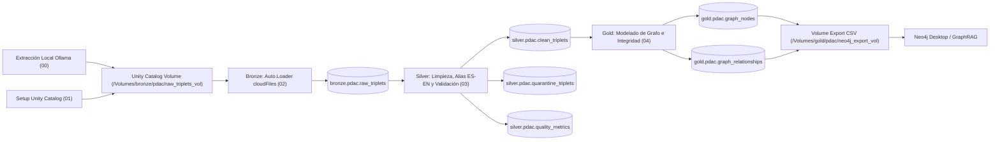

# Documentación Técnica del Pipeline ETL — OncoPancreaticCDSS (Medallion + GraphRAG)

Documentación técnica de referencia del pipeline **OncoPancreaticCDSS**, diseñado sobre **Databricks Unity Catalog (Free Edition Serverless)** con arquitectura Medallion (**Bronze → Silver → Gold**) para transformar tripletas biomédicas de adenocarcinoma ductal pancreático (PDAC) en un grafo de conocimiento listo para **Neo4j Desktop** y consultas **GraphRAG**.

---

## 1. Arquitectura Medallion y Principios de Diseño

El flujo separa la extracción LLM local (ejecutada previamente *offline* en [`00_local_ollama_extraction.ipynb`](file:///c:/Users/adria/Desktop/WorkSpace-Master/OncoPancreaticCDSS-ETL-GraphRAG/notebooks/00_local_ollama_extraction.ipynb)) del procesamiento distribuido y determinista en Databricks.



### Compatibilidad Estricta con Databricks Free Edition Serverless
- **Cero llamadas a LLMs/APIs externas en Databricks:** Toda la normalización, traducción ES→EN, resolución de alias farmacológicos y validación ontológica se implementa con PySpark nativo determinista (`pyspark.sql.functions`, expresiones regulares, *broadcast joins* y funciones de ventana).
- **Sin acceso a DBFS raíz ni APIs restringidas:** Todas las rutas apuntan exclusivamente a **Unity Catalog Volumes** (`/Volumes/...`) y tablas gobernadas de tres niveles (`<catalog>.<schema>.<table>`). No se utilizan `/dbfs/`, `dbfs:/`, `spark.sparkContext`, APIs RDD ni `spark.conf.set(...)`.
- **Resistencia a límites de *codegen* y modo ANSI:** Los diccionarios extensos de alias (`ENTITY_ALIASES`, 1,196 reglas) y reasignaciones de tipo (`ENTITY_TYPE_OVERRIDES`, 120 reglas) se aplican mediante `F.broadcast(spark.createDataFrame(...))` con proyecciones independientes por columna en lugar de mapas gigantes en expresión, evitando el límite de 64 KB de JVM y ambigüedades en *self-joins*. Las búsquedas sobre mapas pequeños usan `F.element_at(...)` seguro bajo `spark.sql.ansi.enabled = true`.
- **Exportación CSV compatible con Spark:** Las tablas Gold aplanan los metadatos de trazabilidad a cadenas delimitadas por `;` (`STRING`) para garantizar compatibilidad directa con `DataFrameWriter.csv(...)`.

---

## 2. Gobernanza en Unity Catalog y Estructura de Volúmenes

Los objetos base de Unity Catalog se crean en [`01_setup.ipynb`](file:///c:/Users/adria/Desktop/WorkSpace-Master/OncoPancreaticCDSS-ETL-GraphRAG/notebooks/01_setup.ipynb) y se amplían con el volumen de exportación en Gold:

| Capa | Catálogo | Esquema | Volúmenes Unity Catalog | Tablas Delta |
| :--- | :--- | :--- | :--- | :--- |
| **Bronze** | `bronze` | `bronze.pdac` | `bronze.pdac.raw_triplets_vol` (`/Volumes/bronze/pdac/raw_triplets_vol`) | `bronze.pdac.raw_triplets` |
| **Silver** | `silver` | `silver.pdac` | — | `silver.pdac.clean_triplets`<br>`silver.pdac.quarantine_triplets`<br>`silver.pdac.quality_metrics` |
| **Gold** | `gold` | `gold.pdac` | `gold.pdac.neo4j_export_vol` (`/Volumes/gold/pdac/neo4j_export_vol`) | `gold.pdac.graph_nodes`<br>`gold.pdac.graph_relationships` |

### Subcarpetas dentro de `/Volumes/bronze/pdac/raw_triplets_vol`
- **Datos fuente (subidos desde `data/03_processed/`):**
  - `01_guias/` (5 JSON, guías clínicas SEOM / ESMO / NCCN — dominio `clinical_guidelines`)
  - `02_papers/` (9 JSON, artículos PubMed sobre KRAS, FOLFIRINOX y resistencia — dominio `pubmed_papers`)
  - `03_ensayos/` (4 JSON, ensayos ClinicalTrials.gov `NCT*` — dominio `clinical_trials`)
  - `04_farmacos/` (4 JSON, fichas técnicas AEMPS/CIMA — dominio `aemps_cima_drugs`)
- **Metadatos internos de Auto Loader (prefijo `_` ignorado automáticamente por `cloudFiles`):**
  - `_checkpoints/bronze_triplets` (`checkpointLocation` del stream)
  - `_schemas/bronze_triplets` (`cloudFiles.schemaLocation`)

---

## 3. Guía de Ejecución por Notebook

### `01_setup.ipynb` — Provisioning de Unity Catalog
- **Archivo:** [`notebooks/01_setup.ipynb`](file:///c:/Users/adria/Desktop/WorkSpace-Master/OncoPancreaticCDSS-ETL-GraphRAG/notebooks/01_setup.ipynb)
- **Propósito:** Crea los catálogos `bronze`, `silver`, `gold`, el esquema `pdac` en cada uno y el volumen `bronze.pdac.raw_triplets_vol`.
- **Precondición de usuario:** Subir las 4 carpetas de [`data/03_processed/`](file:///c:/Users/adria/Desktop/WorkSpace-Master/OncoPancreaticCDSS-ETL-GraphRAG/data/03_processed) al volumen `/Volumes/bronze/pdac/raw_triplets_vol/` manteniendo sus subdirectorios (`01_guias`, `02_papers`, `03_ensayos`, `04_farmacos`).

### `02_bronze_ingestion.ipynb` — Ingesta Incremental Auto Loader
- **Archivo:** [`notebooks/02_bronze_ingestion.ipynb`](file:///c:/Users/adria/Desktop/WorkSpace-Master/OncoPancreaticCDSS-ETL-GraphRAG/notebooks/02_bronze_ingestion.ipynb)
- **Funcionamiento:**
  1. Inspecciona el contenido del volumen con `dbutils.fs.ls` excluyendo directorios `_checkpoints` y `_schemas`.
  2. Lee el stream con `spark.readStream.format("cloudFiles")` configurado con `cloudFiles.format="json"`, **`multiLine="true"`** (imprescindible porque los 22 JSON están indentados en múltiples líneas), `pathGlobFilter="*.json"`, `cloudFiles.inferColumnTypes="true"`, `cloudFiles.schemaHints` explícito para el array `tripletas`, `cloudFiles.schemaEvolutionMode="rescue"` y `rescuedDataColumn="_rescued_data"`.
  3. Despliega `tripletas` con `F.explode_outer("tripletas")` para no perder archivos vacíos ni registros anómalos.
  4. Agrega trazabilidad completa (`_source_file`, `_file_name`, `_file_size`, `_file_modification_time`, `_source_folder`, `_source_domain`, `_ingestion_timestamp`, `_rescued_data`).
  5. Persiste en `bronze.pdac.raw_triplets` usando `.trigger(availableNow=True)` para procesar todo el lote pendiente de forma incremental en modo batch.

### `03_silver_transformation.ipynb` — Limpieza, Resolución de Entidades y Cuarentena
- **Archivo:** [`notebooks/03_silver_transformation.ipynb`](file:///c:/Users/adria/Desktop/WorkSpace-Master/OncoPancreaticCDSS-ETL-GraphRAG/notebooks/03_silver_transformation.ipynb)
- **Funciones modulares PySpark:**
  1. `clean_structural_fields(df)`: Guarda copias crudas (`*_raw`), limpia énfasis Markdown (`_BRCA1_` → `BRCA1`), prefijos AEMPS/CIMA (`De forma rara:`, `De forma frecuente:`) y ClinicalTrials (`Procedure:`), normaliza guiones Unicode (`–`, `—`, `−` → `-`), flechas (`▶` → `->`), barras (`//` → `/`), corchetes truncados (`TMB-H [≥10 mut/Mb` → `TMB-H [≥10 mut/Mb]`), superíndices de nota al pie pegados a palabras largas en minúscula (`intersticial2` → `intersticial`), colapsa espacios y normaliza casing de tipos y predicados.
  2. `resolve_entities_and_translate(df, ENTITY_ALIASES)`: Aplica dos *broadcast joins* contra 1,196 reglas de resolución ES→EN, principios activos, marcas comerciales (`Abraxane` / `Paclitaxel Albumina` → `Nab-Paclitaxel`, `RMC-6236` → `Daraxonrasib`, `DS-8201a` → `Trastuzumab Deruxtecan`), acrónimos clínicos (`PDAC`, `GnP`, `GEM-NABP`, `Nal-IRI`, `CA 19-9`/`CA19.9` → `CA19-9`) y normalización tipográfica.
  3. `standardize_types_and_predicates(df, ENTITY_TYPE_OVERRIDES, PREDICATE_MAP)`: Aplica 120 *overrides* semánticos vía *broadcast* (promoviendo genes a `GENE`, marcadores a `BIOMARKER`, rutas a `PATHWAY`, síntomas a `SYMPTOM` y factores de riesgo a `RISK_FACTOR`, además de resolver conflictos como `Diabetes Mellitus` o `Chemoradiation`), estandariza predicados (`CONTRAINDICATED_IN` → `CONTRAINDICATED_FOR`) y especializa `ASSOCIATED_WITH` hacia `BIOMARKER_FOR`, `HAS_MUTATION` y `RISK_FACTOR_FOR`.
  4. `validate_and_split_quarantine(...)`: Enruta registros defectuosos a `silver.pdac.quarantine_triplets` con `_rejection_reason`.
  5. `resolve_entity_type_consistency(...)` y `deduplicate_triplets(...)`: Unifica cualquier variante residual de capitalización entre documentos, asigna un tipo autoritativo único por entidad mediante función `Window` (frecuencia + prioridad clínica) y deduplica tripletas calculando `evidence_count`, `avg_confidence`, `max_confidence`, `doc_count` y arrays ordenados de procedencia.
  6. Auditoría final **Antes vs. Después** persistida en `silver.pdac.quality_metrics`.

### `04_gold_graph_modeling.ipynb` — Modelado de Grafo y Exportación Neo4j
- **Archivo:** [`notebooks/04_gold_graph_modeling.ipynb`](file:///c:/Users/adria/Desktop/WorkSpace-Master/OncoPancreaticCDSS-ETL-GraphRAG/notebooks/04_gold_graph_modeling.ipynb)
- **Funcionamiento:**
  1. Construye `gold.pdac.graph_nodes` uniendo sujetos y objetos limpios, resolviendo etiquetas por menciones y prioridad (`NODE_TYPE_PRIORITY`), y calculando `node_id` determinista (`n_` + 16 caracteres SHA-256 de `lower(trim(name))`), `mention_count`, `degree`, `doc_count`, `sources` y `source_docs`.
  2. Construye `gold.pdac.graph_relationships` enlazando `silver.pdac.clean_triplets` con dos *broadcast joins* independientes sobre `graph_nodes` para obtener `source_id` y `target_id` verificados y generar `rel_id` (`r_` + 16 caracteres SHA-256 de `source_id|relationship_type|target_id`).
  3. Crea el volumen `gold.pdac.neo4j_export_vol` y exporta un único archivo CSV con cabecera y comillas completas (`coalesce(1)`, `quoteAll=true`) para nodos y relaciones.
  4. Ejecuta aserciones estrictas (`assert == 0`) de integridad referencial (0 aristas huérfanas, 0 claves nulas/duplicadas, 0 auto-bucles) e imprime subgrafos clínicos reales de PDAC (`KRAS`, `KRAS G12D`, `Gemcitabine`, `Nab-Paclitaxel`, `CA19-9`, `Pancreatic Ductal Adenocarcinoma`).

---

## 4. Reglas de Calidad, Ontología y Cuarentena (Capa Silver)

### Hallazgos Reales en `data/03_processed/` que Motivan las Reglas
Al inspeccionar los 22 archivos JSON reales (`2,700` tripletas, `1,830` entidades crudas sensibles a mayúsculas), se detectaron cinco patrones críticos:
1. **Mezcla bilingüe intensa:** Fármacos (`Gemcitabina`/`Gemcitabine`/`GEM`, `Paclitaxel Albumina`/`Nab-paclitaxel`), enfermedades (`Adenocarcinoma de páncreas`/`PDAC`/`Pancreatic ductal adenocarcinoma`), procedimientos (`Radioterapia`/`RT`, `TC`/`CT`) y casi 400 eventos adversos en español procedentes de las fichas técnicas AEMPS/CIMA (`04_farmacos`).
2. **Ruido de extracción y marcadores de origen:** Prefijos `De forma rara:`, `De forma frecuente:`, `Procedure:`, énfasis `_BRCA1_`, superíndices `intersticial2`, `pares craneales1`, guiones largos `miR-3173–5p` y flechas `CT ▶CRT ▶SRG`.
3. **Fragmentación molecular y comercial:** Fármacos experimentales y comerciales divididos (`RMC-6236` y `Daraxonrasib`; `DS-8201a` y `Fam-trastuzumab deruxtecan-nxki`; `CA 19-9`, `CA19.9` y `CA19-9`).
4. **Conflictos entre tipos de nodo (28 casos detectados):** Entidades clasificadas simultáneamente en dos categorías (ej. `metastatic disease` como `STAGE` y `DISEASE`, `diabetes` como `ADVERSE_EVENT` y `DISEASE`, `chemoradiation` como `PROCEDURE` y `REGIMEN`).
5. **Ruido genérico y violaciones ontológicas:** Conceptos vagos o encabezados MedDRA (`Death`, `Ampullary`, `Other extrapancreatic disease`, `Infecciones e infestaciones`, `Trastornos del sistema nervioso`), auto-bucles tras resolución de alias y relaciones imposibles (`DRUG -[DIAGNOSES]-> DISEASE`, `REGIMEN -[COMBINES_WITH]-> REGIMEN`).

### Catálogo Ontológico Estandarizado (Gold/Silver)
- **Tipos de nodo permitidos (`VALID_NODE_TYPES`, 13 categorías):**
  `DRUG`, `REGIMEN`, `GENE`, `MUTATION`, `BIOMARKER`, `PATHWAY`, `DISEASE`, `STAGE`, `PROCEDURE`, `TRIAL`, `RISK_FACTOR`, `SYMPTOM`, `ADVERSE_EVENT`.
- **Predicados permitidos (`VALID_PREDICATES`, 11 relaciones en `UPPER_SNAKE_CASE`):**
  `TREATS`, `COMBINES_WITH`, `CAUSES`, `CONTRAINDICATED_FOR`, `TARGETS`, `EVALUATED_IN`, `DIAGNOSES`, `ASSOCIATED_WITH`, `BIOMARKER_FOR`, `HAS_MUTATION`, `RISK_FACTOR_FOR`, `INHIBITS`.

### Motivos de Cuarentena (`_rejection_reason`)
1. `NULL_CORE_FIELD`: Sujeto, objeto o predicado nulo o vacío tras limpieza.
2. `INVALID_ENTITY_LENGTH`: Entidad con menos de 2 caracteres o más de 80 caracteres (frases largas mal extraídas).
3. `LOW_CONFIDENCE_SCORE`: Confianza nula, menor a `0.70` o superior a `1.0`.
4. `INVALID_SUBJECT_TYPE` / `INVALID_OBJECT_TYPE`: Tipo fuera de `VALID_NODE_TYPES`.
5. `INVALID_PREDICATE`: Relación fuera de `VALID_PREDICATES`.
6. `SELF_LOOP_TRIPLET`: Sujeto y objeto idénticos tras resolución de alias (ej. `Neoadjuvant Chemotherapy` combinado consigo mismo).
7. `GENERIC_OR_NOISE_ENTITY`: Entidades en `GENERIC_NOISE_ENTITIES` (placeholders, encabezados MedDRA, criterios analíticos) o ensayos genéricos sin identificador (`Phase I trial`, `Phase 1/2 trial`).
8. `INVALID_ONTOLOGY_RELATION`: Violaciones de dominio/rango (ej. `REGIMEN -[COMBINES_WITH]-> REGIMEN`, `DRUG -[DIAGNOSES]-> *`, `DISEASE -[TREATS]-> *`, `* -[EVALUATED_IN]-> no-TRIAL`, `CAUSES -> DRUG/PROCEDURE/TRIAL`).

### Métricas Baseline Verificadas sobre el Corpus Actual (22 JSON / 2,700 tripletas)
*(Valores obtenidos en simulación determinista exacta sobre [`data/03_processed/`](file:///c:/Users/adria/Desktop/WorkSpace-Master/OncoPancreaticCDSS-ETL-GraphRAG/data/03_processed); al ejecutar en Databricks los resultados en `silver.pdac.quality_metrics` coincidirán con esta línea base salvo que se añadan nuevos archivos).*

| Métrica | Valor | Detalle |
| :--- | :---: | :--- |
| **Tripletas crudas ingeridas (Bronze)** | **2,700** | 22 archivos en 4 carpetas |
| **Tripletas válidas pre-deduplicación** | **2,598** | 96.22% del corpus crudo |
| **Tripletas en cuarentena** | **102 (3.78%)** | 96 `GENERIC_OR_NOISE_ENTITY`, 4 `SELF_LOOP_TRIPLET`, 2 `INVALID_ONTOLOGY_RELATION` |
| **Tripletas únicas limpias (Silver)** | **2,024** | **-22.09%** por deduplicación con consolidación de evidencias |
| **Entidades únicas crudas (case-sensitive)** | **1,830** | 1,728 insensibles a mayúsculas |
| **Nodos canónicos en inglés (Gold)** | **1,165** | **-36.34%** de reducción dimensional tras alias/traducción (0 términos con acentos residuales) |
| **Integridad referencial Gold** | **100% PASS** | 0 aristas huérfanas, 0 IDs duplicados, 0 auto-bucles |

---

## 5. Diccionario de Datos de Tablas Delta

### 5.1 `bronze.pdac.raw_triplets`

| Columna | Tipo Spark | Nulable | Descripción |
| :--- | :--- | :---: | :--- |
| `doc_id` | `STRING` | Sí | Identificador del documento extraído en el JSON (`doc_id`). |
| `categoria` | `STRING` | Sí | Categoría documental original (`01_guias` .. `04_farmacos`). |
| `sujeto` | `STRING` | Sí | Entidad origen cruda sin modificar. |
| `tipo_sujeto` | `STRING` | Sí | Tipo de entidad sujeto crudo. |
| `relacion` | `STRING` | Sí | Predicado crudo extraído. |
| `objeto` | `STRING` | Sí | Entidad destino cruda sin modificar. |
| `tipo_objeto` | `STRING` | Sí | Tipo de entidad objeto crudo. |
| `score` | `DOUBLE` | Sí | Puntuación de confianza asignada por la extracción (0.70–0.99). |
| `_source_file` | `STRING` | No | Ruta completa en el Volumen UC (`_metadata.file_path`). |
| `_file_name` | `STRING` | No | Nombre del archivo JSON (`_metadata.file_name`). |
| `_file_size` | `LONG` | No | Tamaño del archivo en bytes (`_metadata.file_size`). |
| `_file_modification_time` | `TIMESTAMP` | No | Última modificación del archivo fuente. |
| `_source_folder` | `STRING` | No | Subcarpeta origen (`01_guias`, `02_papers`, `03_ensayos`, `04_farmacos`). |
| `_source_domain` | `STRING` | No | Dominio legible (`clinical_guidelines`, `pubmed_papers`, `clinical_trials`, `aemps_cima_drugs`). |
| `_ingestion_timestamp` | `TIMESTAMP` | No | Marca temporal de escritura en Bronze. |
| `_rescued_data` | `STRING` | Sí | JSON de campos inesperados o mal tipados capturados por Auto Loader. |

### 5.2 `silver.pdac.clean_triplets`

| Columna | Tipo Spark | Nulable | Descripción |
| :--- | :--- | :---: | :--- |
| `subject` | `STRING` | No | Nombre canónico en inglés del sujeto. |
| `subject_type` | `STRING` | No | Tipo semántico único y validado (`VALID_NODE_TYPES`). |
| `predicate` | `STRING` | No | Relación normalizada en `UPPER_SNAKE_CASE` (`VALID_PREDICATES`). |
| `object` | `STRING` | No | Nombre canónico en inglés del objeto. |
| `object_type` | `STRING` | No | Tipo semántico único y validado (`VALID_NODE_TYPES`). |
| `evidence_count` | `INT` | No | Número de extracciones consolidadas para esta tripleta única. |
| `avg_confidence` | `DOUBLE` | No | Promedio de `confidence` entre todas las menciones consolidadas. |
| `max_confidence` | `DOUBLE` | No | Máxima confianza observada. |
| `doc_count` | `INT` | No | Número de documentos distintos que respaldan la tripleta. |
| `source_docs` | `ARRAY<STRING>` | No | Lista ordenada de `doc_id` donde aparece la relación. |
| `source_files` | `ARRAY<STRING>` | No | Lista ordenada de `_source_file` de procedencia. |
| `source_folders` | `ARRAY<STRING>` | No | Subcarpetas de origen consolidadas. |
| `source_domains` | `ARRAY<STRING>` | No | Dominios documentales consolidados. |
| `_processed_at` | `TIMESTAMP` | No | Marca temporal de procesamiento en Silver. |

### 5.3 `silver.pdac.quarantine_triplets`

| Columna | Tipo Spark | Nulable | Descripción |
| :--- | :--- | :---: | :--- |
| `doc_id`, `categoria` | `STRING` | Sí | Identificador de documento y categoría de Bronze. |
| `subject_raw`, `object_raw`, `predicate_raw` | `STRING` | Sí | Valores originales antes de limpieza estructural. |
| `subject_type_raw`, `object_type_raw` | `STRING` | Sí | Tipos originales antes de normalización. |
| `subject`, `object`, `predicate` | `STRING` | Sí | Valores normalizados sobre los que falló la validación. |
| `subject_type`, `object_type` | `STRING` | Sí | Tipos evaluados en la regla de calidad. |
| `confidence` | `DOUBLE` | Sí | Puntuación redondeada a 4 decimales. |
| `_source_file`, `_source_folder`, `_source_domain` | `STRING` | No | Trazabilidad heredada de Bronze. |
| `_rejection_reason` | `STRING` | No | Código determinista del motivo de cuarentena. |
| `_quarantined_at` | `TIMESTAMP` | No | Marca temporal de envío a cuarentena. |

### 5.4 `silver.pdac.quality_metrics`

| Columna | Tipo Spark | Nulable | Descripción |
| :--- | :--- | :---: | :--- |
| `metric_name` | `STRING` | No | Identificador de métrica Antes vs. Después. |
| `metric_value` | `LONG` | No | Valor numérico auditado. |
| `notes` | `STRING` | No | Descripción y porcentaje comparativo. |
| `_audited_at` | `TIMESTAMP` | No | Marca temporal de auditoría. |

### 5.5 `gold.pdac.graph_nodes`

| Columna | Tipo Spark | Nulable | Descripción |
| :--- | :--- | :---: | :--- |
| `node_id` | `STRING` | No | Clave primaria determinista (`n_` + 16 hex SHA-256 de `lower(trim(name))`). |
| `name` | `STRING` | No | Nombre canónico único en inglés (sin duplicados). |
| `label` | `STRING` | No | Etiqueta principal del nodo para Neo4j (`DISEASE`, `DRUG`, `GENE`, etc.). |
| `mention_count` | `INT` | No | Suma total de menciones (`evidence_count`) en todas sus aristas incidentes. |
| `degree` | `INT` | No | Grado del nodo (número de aristas únicas conectadas). |
| `doc_count` | `INT` | No | Número de documentos únicos que mencionan la entidad. |
| `sources` | `STRING` | No | Dominios fuente concatenados con `;`. |
| `source_docs` | `STRING` | No | `doc_id`s concatenados con `;`. |

### 5.6 `gold.pdac.graph_relationships`

| Columna | Tipo Spark | Nulable | Descripción |
| :--- | :--- | :---: | :--- |
| `rel_id` | `STRING` | No | Identificador único determinista (`r_` + 16 hex SHA-256 de `source_id|relationship_type|target_id`). |
| `source_id` | `STRING` | No | Clave foránea hacia `gold.pdac.graph_nodes.node_id` (nodo origen). |
| `target_id` | `STRING` | No | Clave foránea hacia `gold.pdac.graph_nodes.node_id` (nodo destino). |
| `source_name` | `STRING` | No | Nombre legible del nodo origen. |
| `source_label` | `STRING` | No | Etiqueta del nodo origen. |
| `relationship_type` | `STRING` | No | Tipo de arista en `UPPER_SNAKE_CASE` (`TREATS`, `TARGETS`, etc.). |
| `target_name` | `STRING` | No | Nombre legible del nodo destino. |
| `target_label` | `STRING` | No | Etiqueta del nodo destino. |
| `evidence_count` | `INT` | No | Peso cuantitativo de evidencias acumuladas. |
| `avg_confidence` | `DOUBLE` | No | Confianza media de la relación. |
| `max_confidence` | `DOUBLE` | No | Confianza máxima observada. |
| `doc_count` | `INT` | No | Documentos distintos que respaldan la relación. |
| `source_domains` | `STRING` | No | Dominios documentales delimitados por `;`. |
| `source_files` | `STRING` | No | Archivos de origen delimitados por `;`. |

---

## 6. Guía de Exportación e Ingesta en Neo4j Desktop

### Paso 1: Descargar los CSV desde Databricks Unity Catalog
1. En Databricks Workspace, abre **Catalog → `gold` → `pdac` → Volumes → `neo4j_export_vol`**.
2. Dentro de `graph_nodes/`, descarga el archivo `part-00000-*.csv` y renómbralo a **`graph_nodes.csv`**.
3. Dentro de `graph_relationships/`, descarga el archivo `part-00000-*.csv` y renómbralo a **`graph_relationships.csv`**.
4. *(Alternativa)* Desde el SQL Editor de Databricks ejecuta `SELECT * FROM gold.pdac.graph_nodes` y `SELECT * FROM gold.pdac.graph_relationships` y usa **Download CSV**.
5. Abre **Neo4j Desktop**, pulsa **`...` → Open Folder → Import** en tu base de datos local y copia dentro ambos archivos (`graph_nodes.csv` y `graph_relationships.csv`).

### Paso 2: Crear Constraints e Índices en Neo4j Browser
Ejecuta primero estos comandos en **Neo4j Browser** para garantizar unicidad y acelerar el enlace de aristas:

```cypher
CREATE CONSTRAINT entity_node_id IF NOT EXISTS
FOR (n:Entity) REQUIRE n.node_id IS UNIQUE;

CREATE INDEX entity_name_idx IF NOT EXISTS
FOR (n:Entity) ON (n.name);
```

### Paso 3: Cargar Nodos y Relaciones (Con APOC recomendado)
Si tu DBMS en Neo4j Desktop tiene instalado el plugin **APOC** (disponible en el menú Plugins con un clic), este script asigna dinámicamente tanto `:Entity` como la etiqueta clínica específica (`:DRUG`, `:DISEASE`, `:GENE`, `:BIOMARKER`, etc.) y el tipo de relación real (`[:TREATS]`, `[:TARGETS]`, etc.):

```cypher
// 1. Cargar Nodos con etiqueta dinámica + :Entity
LOAD CSV WITH HEADERS FROM 'file:///graph_nodes.csv' AS row
CALL apoc.create.node(['Entity', row.label], {
  node_id: row.node_id,
  name: row.name,
  label: row.label,
  mention_count: toInteger(row.mention_count),
  degree: toInteger(row.degree),
  doc_count: toInteger(row.doc_count),
  sources: split(row.sources, ';'),
  source_docs: split(row.source_docs, ';')
}) YIELD node
RETURN count(node) AS nodos_cargados;

// 2. Cargar Aristas con relationship_type dinámico
LOAD CSV WITH HEADERS FROM 'file:///graph_relationships.csv' AS row
MATCH (src:Entity {node_id: row.source_id})
MATCH (tgt:Entity {node_id: row.target_id})
CALL apoc.create.relationship(src, row.relationship_type, {
  rel_id: row.rel_id,
  evidence_count: toInteger(row.evidence_count),
  avg_confidence: toFloat(row.avg_confidence),
  max_confidence: toFloat(row.max_confidence),
  doc_count: toInteger(row.doc_count),
  source_domains: split(row.source_domains, ';'),
  source_files: split(row.source_files, ';')
}, tgt) YIELD rel
RETURN count(rel) AS relaciones_cargadas;
```

### Alternativa en Cypher Puro (Sin plugin APOC)
Si prefieres no instalar APOC, puedes cargar las aristas con relación genérica `:CLINICAL_REL` conservando `type` y `label` como propiedades indexadas:

```cypher
// Nodos sin APOC
LOAD CSV WITH HEADERS FROM 'file:///graph_nodes.csv' AS row
MERGE (n:Entity {node_id: row.node_id})
SET n.name = row.name,
    n.label = row.label,
    n.mention_count = toInteger(row.mention_count),
    n.degree = toInteger(row.degree),
    n.doc_count = toInteger(row.doc_count),
    n.sources = split(row.sources, ';'),
    n.source_docs = split(row.source_docs, ';');

// Relaciones sin APOC
LOAD CSV WITH HEADERS FROM 'file:///graph_relationships.csv' AS row
MATCH (src:Entity {node_id: row.source_id})
MATCH (tgt:Entity {node_id: row.target_id})
MERGE (src)-[r:CLINICAL_REL {rel_id: row.rel_id}]->(tgt)
SET r.relationship_type = row.relationship_type,
    r.evidence_count = toInteger(row.evidence_count),
    r.avg_confidence = toFloat(row.avg_confidence),
    r.max_confidence = toFloat(row.max_confidence),
    r.doc_count = toInteger(row.doc_count),
    r.source_domains = split(row.source_domains, ';');
```

### Paso 4: Consultas de Verificación y GraphRAG en Neo4j
```cypher
// 1. Conteo global de nodos y relaciones cargadas
MATCH (n:Entity) WITH count(n) AS nodes
MATCH ()-[r]->() RETURN nodes, count(r) AS relationships;

// 2. Subgrafo terapéutico y molecular alrededor de KRAS y KRAS G12D
MATCH (s:Entity)-[r]-(t:Entity)
WHERE s.name IN ['KRAS', 'KRAS G12D']
RETURN s, r, t
ORDER BY r.evidence_count DESC
LIMIT 40;

// 3. Fármacos y regímenes que tratan PDAC con mayor respaldo documental
MATCH (tx:Entity)-[r:TREATS]->(d:Entity {name: 'Pancreatic Ductal Adenocarcinoma'})
RETURN tx.name AS terapia, tx.label AS tipo, r.evidence_count AS evidencias, r.avg_confidence AS confianza
ORDER BY evidencias DESC, confianza DESC
LIMIT 20;

// 4. Combinaciones y toxicidades principales de Gemcitabine y Nab-Paclitaxel
MATCH (drug:Entity)-[r:COMBINES_WITH|CAUSES]->(target:Entity)
WHERE drug.name IN ['Gemcitabine', 'Nab-Paclitaxel']
RETURN drug.name AS farmaco, type(r) AS relacion, target.name AS objetivo, target.label AS categoria, r.evidence_count AS evidencias
ORDER BY evidencias DESC
LIMIT 30;
```
