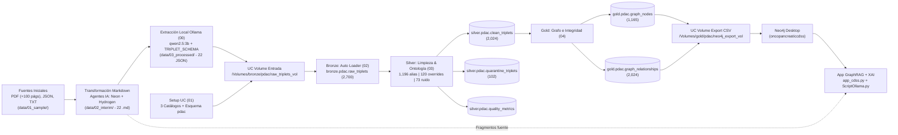
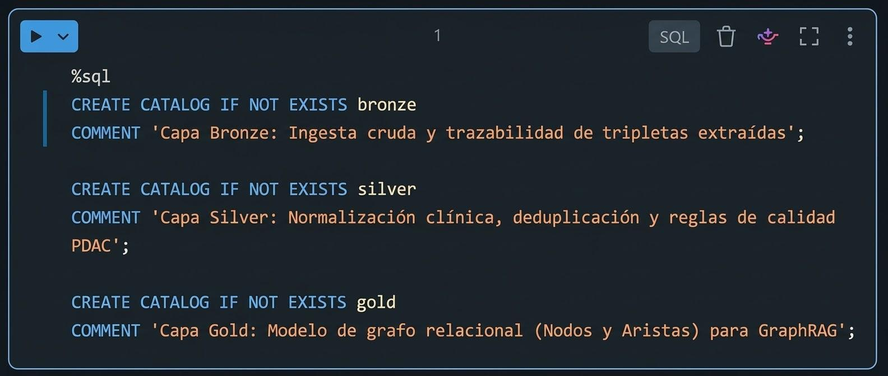
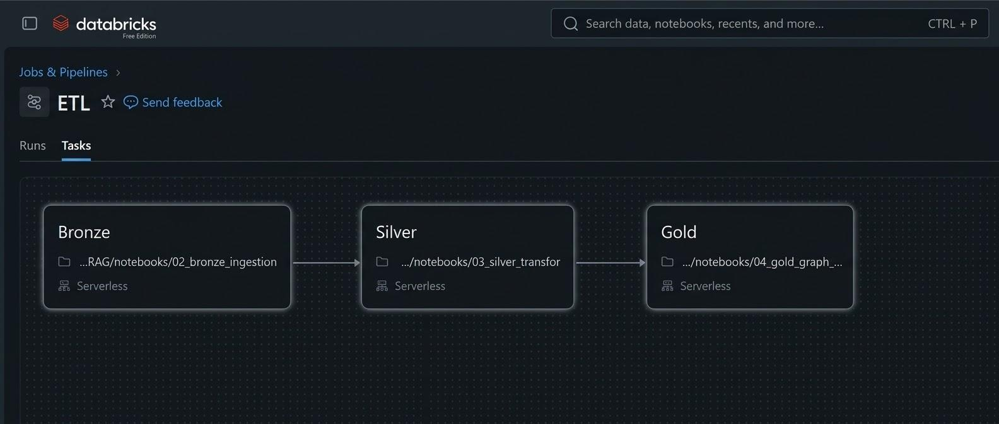
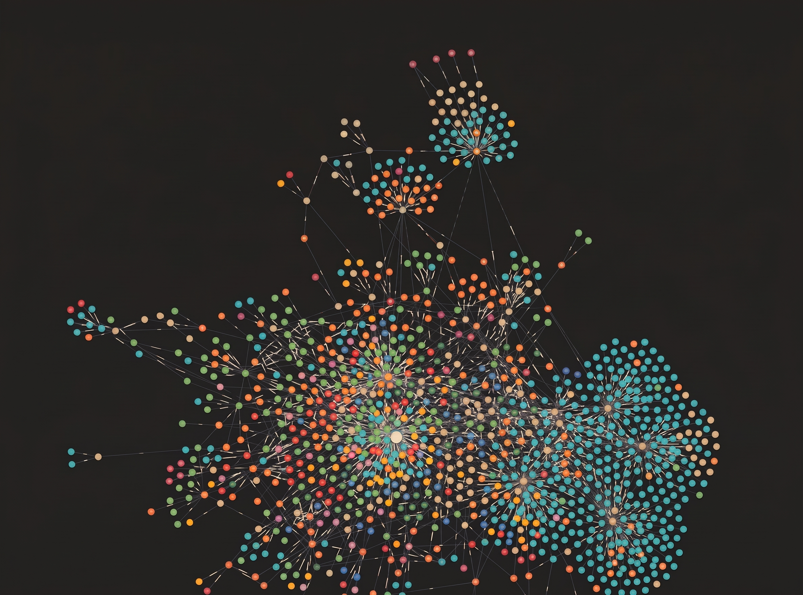
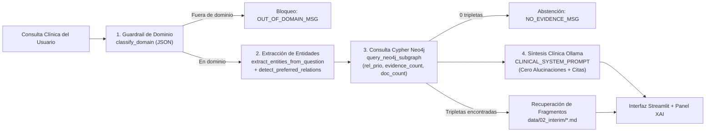
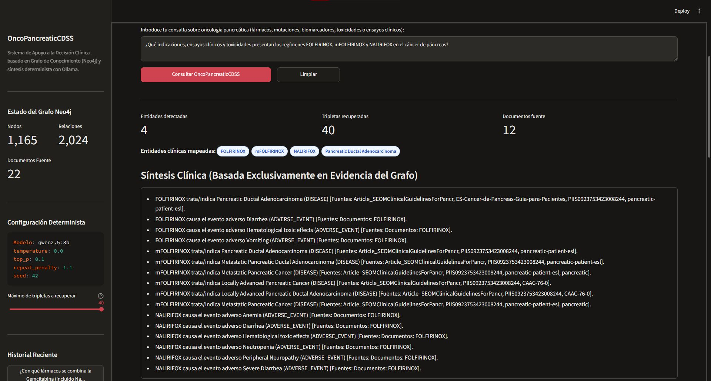
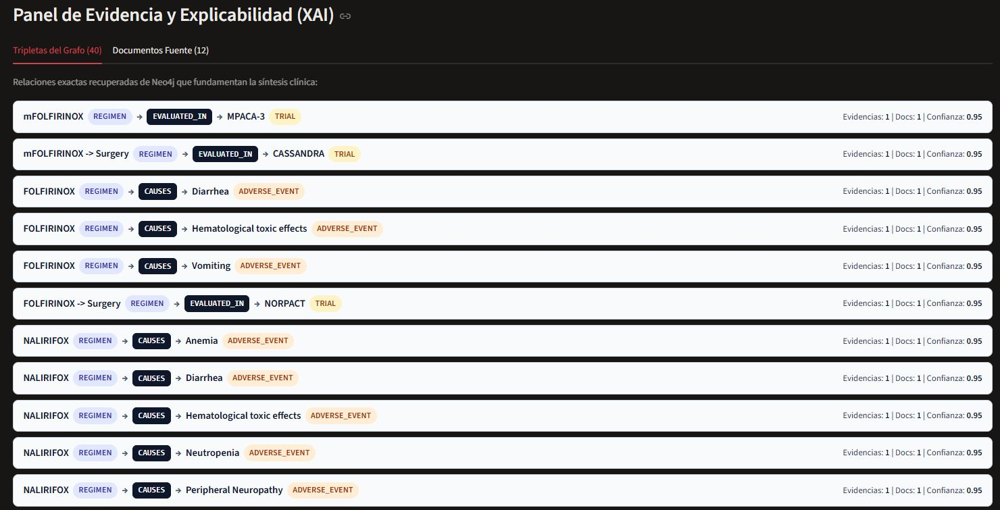

# Documentación Técnica Definitiva — OncoPancreaticCDSS (ETL Medallion + GraphRAG)

| Campo | Detalle |
| :--- | :--- |
| **Proyecto** | **OncoPancreaticCDSS-ETL-GraphRAG** |
| **Autor** | Adrián Vivar Moreno |
| **Dominio clínico** | Adenocarcinoma Ductal Pancreático (PDAC) |
| **Arquitectura** | Extracción Local LLM (Ollama) → Lakehouse Medallion en Databricks Unity Catalog (Bronze → Silver → Gold) → Grafo Neo4j → Aplicación GraphRAG + XAI (Streamlit + Ollama) |
| **Entorno Cloud** | Databricks Free Edition Serverless (Unity Catalog + Delta Lake + Auto Loader) |
| **Entorno Local** | Python, Ollama (`qwen2.5:3b`), Neo4j Desktop (+ APOC), Streamlit |

---

## Tabla de Contenidos

1. [Introducción, Objetivos y Arquitectura End-to-End](#1-introducción-objetivos-y-arquitectura-end-to-end)
2. [Fuentes Iniciales de Datos (`data/01_sample/` y Corpus Completo)](#2-fuentes-iniciales-de-datos-data01_sample-y-corpus-completo)
3. [Transformación a Markdown Estructurado (`data/02_interim/`)](#3-transformación-a-markdown-estructurado-data02_interim)
4. [Extracción Local de Tripletas con Ollama (`00_local_ollama_extraction.ipynb` → `data/03_processed/`)](#4-extracción-local-de-tripletas-con-ollama-00_local_ollama_extractionipynb--data03_processed)
5. [Gobernanza en Databricks Unity Catalog (`01_setup.ipynb`)](#5-gobernanza-en-databricks-unity-catalog-01_setupipynb)
6. [Capa Bronze: Ingesta Incremental con Auto Loader (`02_bronze_ingestion.ipynb`)](#6-capa-bronze-ingesta-incremental-con-auto-loader-02_bronze_ingestionipynb)
7. [Capa Silver: Limpieza, Resolución de Entidades, Ontología y Cuarentena (`03_silver_transformation.ipynb`)](#7-capa-silver-limpieza-resolución-de-entidades-ontología-y-cuarentena-03_silver_transformationipynb)
8. [Capa Gold: Modelado de Grafo, Integridad Referencial y Exportación CSV (`04_gold_graph_modeling.ipynb`)](#8-capa-gold-modelado-de-grafo-integridad-referencial-y-exportación-csv-04_gold_graph_modelingipynb)
9. [Grafo de Conocimiento en Neo4j Desktop](#9-grafo-de-conocimiento-en-neo4j-desktop)
10. [Aplicación de Consulta GraphRAG al Grafo con Ollama y Streamlit (`app/`)](#10-aplicación-de-consulta-graphrag-al-grafo-con-ollama-y-streamlit-app)
11. [Guía de Despliegue, Configuración y Orden Completo de Ejecución](#11-guía-de-despliegue-configuración-y-orden-completo-de-ejecución)

---

## 1. Introducción, Objetivos y Arquitectura End-to-End

**OncoPancreaticCDSS** es un Sistema de Apoyo a la Decisión Clínica (CDSS) orientado a oncología pancreática, específicamente al **Adenocarcinoma Ductal Pancreático (PDAC)**. Su objetivo es convertir literatura clínica heterogénea y multilingüe en un **grafo de conocimiento auditado** y consultable en lenguaje natural mediante un flujo **GraphRAG determinista** con trazabilidad bibliográfica completa y explicabilidad (**XAI**).

El diseño separa de forma estricta tres planos de ejecución:
1. **Plano de preparación y extracción local (Fases 0–2):** conversión documental asistida por agentes de IA y extracción de tripletas mediante LLM local (`qwen2.5:3b` en Ollama) con validación de *grounding* y esquema JSON estricto.
2. **Plano ETL determinista en la nube (Fase 3):** procesamiento distribuido en **Databricks Unity Catalog (Free Edition Serverless)** bajo arquitectura **Medallion (`bronze` → `silver` → `gold`)**, sin llamadas a APIs externas ni LLMs en el clúster.
3. **Plano de grafo y explotación clínica (Fases 4–5):** carga en **Neo4j Desktop**, consulta Cypher priorizada por evidencia y síntesis determinista en español (`temperature = 0.0`) sobre interfaz **Streamlit**.



### Principios de Compatibilidad Estricta con Databricks Free Edition Serverless
- **Cero llamadas a LLMs o APIs externas en Databricks:** toda la normalización, traducción ES→EN, resolución de alias farmacológicos, desambiguación de tipos y validación ontológica se implementa en **PySpark nativo determinista** (`pyspark.sql.functions`, expresiones regulares, *broadcast joins* y funciones `Window`).
- **Gobernanza exclusiva sobre Unity Catalog:** todas las rutas utilizan **Unity Catalog Volumes** (`/Volumes/<catalog>/<schema>/<volume>`) y tablas Delta de tres niveles (`<catalog>.<schema>.<table>`). No se usan `/dbfs/`, `dbfs:/`, `spark.sparkContext`, APIs RDD ni `spark.conf.set(...)`.
- **Resistencia a límites de *codegen* y modo ANSI:** los diccionarios extensos (`ENTITY_ALIASES` con 1,196 reglas y `ENTITY_TYPE_OVERRIDES` con 120 reglas) se aplican mediante `F.broadcast(spark.createDataFrame(...))` con proyecciones independientes por columna para evitar el límite de 64 KB de JVM y ambigüedades en *self-joins*. Las búsquedas sobre mapas pequeños usan `F.element_at(...)` seguro bajo `spark.sql.ansi.enabled = true`.
- **Exportación CSV compatible con Spark:** las tablas Gold aplanan los arrays de trazabilidad a cadenas delimitadas por `;` (`STRING`) para exportación directa mediante `DataFrameWriter.csv(...)`.

---

## 2. Fuentes Iniciales de Datos (`data/01_sample/` y Corpus Completo)

El corpus clínico del proyecto reúne **22 documentos primarios** seleccionados para cubrir todo el espectro asistencial del cáncer de páncreas: guías de práctica clínica, investigación molecular traslacional, ensayos clínicos activos y fichas técnicas oficiales de quimioterapia. Los documentos PDF de partida alcanzan extensiones superiores a **+100 páginas por PDF** (como las guías NCCN).

| Carpeta / Categoría | N.º Documentos | Fuente / Institución | Idioma | Contenido Principal |
| :--- | :---: | :--- | :---: | :--- |
| `01_guias` | **5** | **SEOM**, **ESMO**, **NCCN** | ES / EN | Diagnóstico, estadificación, cirugía, adyuvancia, enfermedad metastásica y guías para pacientes |
| `02_papers` | **9** | **PubMed** / revistas oncológicas | EN / ES | Mutaciones `KRAS` (`KRAS G12D`), resistencia a Gemcitabina, microambiente tumoral, comparación `NALIRIFOX` vs. `FOLFIRINOX` vs. `GEM-NABP` |
| `03_ensayos` | **4** | **ClinicalTrials.gov** (`NCT*`) | EN | Protocolos, brazos experimentales, criterios de inclusión y biomarcadores (`BRCA1/2`, `PALB2`, `KRAS`, inmunoterapia) |
| `04_farmacos` | **4** | **AEMPS / CIMA** | ES | Fichas técnicas oficiales: indicaciones, contraindicaciones, interacciones y perfil completo de reacciones adversas |

### Muestra Incluida en el Repositorio (`data/01_sample/`)
En [`data/01_sample/`](data/01_sample) se conservan cuatro ejemplos representativos de los formatos de entrada originales (los ficheros masivos en bruto se excluyen en [`.gitignore`](.gitignore) mediante `data/01_raw/`):

1. [`Article_SEOMClinicalGuidelinesForPancr.pdf`](data/01_sample/Article_SEOMClinicalGuidelinesForPancr.pdf) — Guía clínica de la SEOM en PDF.
2. [`Resistencia_farmacos.txt`](data/01_sample/Resistencia_farmacos.txt) — Texto completo del artículo *"Gemcitabine Actions and Resistance Mechanisms in Pancreatic Ductal Adenocarcinoma"* (46,312 bytes).
3. [`NCT06115499.json`](data/01_sample/NCT06115499.json) — JSON estructurado de ClinicalTrials.gov del ensayo **PLATINUM** (`Phase II/III Second-Line NABPLAGEM vs. Nab-Paclitaxel/Gemcitabine in BRCA1/2 or PALB2 Mutant Metastatic PDAC`, 75,267 bytes).
4. [`Gemcitabina.txt`](data/01_sample/Gemcitabina.txt) — Ficha técnica AEMPS/CIMA de *Gemcitabina Hospira 200 mg / 1 000 mg / 2 000 mg* (1,603 líneas).

---

## 3. Transformación a Markdown Estructurado (`data/02_interim/`)

Dado que los PDFs extensos, los JSON anidados de ClinicalTrials.gov y los textos planos de AEMPS presentan saltos de página, cabeceras repetitivas y estructuras incompatibles con un *chunking* homogéneo, la **Fase 1** unifica las 22 fuentes a **Markdown estructurado** (`#`, `##`, `###`).

Este paso se realizó mediante **Agentes de IA**: el **orquestador Neon de Antigravity** coordinando **modelos ligeros Hydrogen** para convertir y limpiar cada documento manteniendo intacta su jerarquía de secciones (por ejemplo, `## 4.1. Indicaciones terapéuticas`, `## 4.3. Contraindicaciones`, `## 4.8. Reacciones adversas` en fichas AEMPS; o `## Summary and Narrative Description`, `## Arms and Interventions` en ensayos NCT).

### Inventario Completo de los 22 Documentos Markdown (`data/02_interim/`)

| Categoría | Archivo `.md` | Título del Documento | Líneas | Caracteres | Tripletas en `03_processed` |
| :--- | :--- | :--- | :---: | :---: | :---: |
| `01_guias` | `Article_SEOMClinicalGuidelinesForPancr.md` | SEOM clinical guidelines for pancreatic and biliary tract cancer (2020) | 294 | 44,192 | 216 |
| `01_guias` | `ES-Cancer-de-Pancreas-Guia-para-Pacientes.md` | Cáncer de páncreas: Una guía ESMO para pacientes | 458 | 56,787 | 189 |
| `01_guias` | `pancreatic-patient-esl.md` | Cáncer pancreático: Guía de NCCN para pacientes | 1,646 | 108,282 | 219 |
| `01_guias` | `pancreatic.md` | NCCN Clinical Practice Guidelines in Oncology: Pancreatic Adenocarcinoma | 1,443 | 232,494 | 522 |
| `01_guias` | `PIIS0923753423008244.md` | Pancreatic cancer: ESMO Clinical Practice Guideline for diagnosis, treatment and follow-up | 475 | 53,414 | 155 |
| `02_papers` | `1-s2.0-S1368764623000432-main.md` | Cancer-associated fibroblasts suppress ferroptosis and induce gemcitabine resistance in pancreatic cancer | 82 | 24,409 | 24 |
| `02_papers` | `20191119-Evolucion-2013-18-de-la-superv-con-tto-adyuv-Cancer-Pancreas-1.md` | Evolución desde 2013 a 2018 de la supervivencia con los tratamientos adyuvantes en cáncer de páncreas | 115 | 21,159 | 21 |
| `02_papers` | `CAAC-76-0.md` | Advances in pancreatic cancer early diagnosis, prevention, and treatment: The past, the present, and the future | 263 | 86,811 | 204 |
| `02_papers` | `FOLFIRINOX.md` | Comparative Efficacy and Safety of NALIRIFOX, FOLFIRINOX, and Nab-Paclitaxel Plus Gemcitabine (GEM-NABP) | 53 | 12,120 | 18 |
| `02_papers` | `nihms-1919288.md` | KRASG12D inhibition reprograms the tumor microenvironment of early and advanced pancreatic cancer | 63 | 21,981 | 48 |
| `02_papers` | `OncolRes-32-45356.md` | Targeting KRAS in pancreatic cancer | 69 | 21,636 | 78 |
| `02_papers` | `Resistencia_farmacos.md` | Gemcitabine Actions and Resistance Mechanisms in Pancreatic Ductal Adenocarcinoma | 171 | 44,905 | 129 |
| `02_papers` | `TCA-16-e70203.md` | Targeting KRAS G12D: Advances in Inhibitor Design | 110 | 26,061 | 72 |
| `02_papers` | `TRABAJO DE Cancer Pancreas.md` | Medicamentos oncológicos en el tratamiento del carcinoma ductal pancreático: efectos adversos e impacto | 37 | 8,695 | 62 |
| `03_ensayos` | `NCT04390399.md` | Combination Immunotherapy Plus Standard-of-Care Chemotherapy Versus Standard-of-Care Chemotherapy | 121 | 11,817 | 33 |
| `03_ensayos` | `NCT04953962.md` | Study of CBP501/Cisplatin/Nivolumab Combinations in Advanced Pancreatic Cancer | 110 | 9,700 | 23 |
| `03_ensayos` | `NCT06115499.md` | The PLATINUM Trial: Second-Line NABPLAGEM vs. Nab-Paclitaxel/Gemcitabine in BRCA1/2 or PALB2 Mutant PDAC | 118 | 10,624 | 42 |
| `03_ensayos` | `NCT07619521.md` | Testing the Combination of Anti-Cancer Drugs, Selumetinib and DS-8201a (Trastuzumab Deruxtecan) | 144 | 20,362 | 55 |
| `04_farmacos` | `Gemcitabina.md` | Gemcitabina Hospira (200 mg / 1 000 mg / 2 000 mg concentrado para solución para perfusión) | 138 | 19,306 | 111 |
| `04_farmacos` | `Irinotecan.md` | Irinotecán Glenmark 20 mg/mL concentrado para solución para perfusión EFG | 328 | 42,517 | 144 |
| `04_farmacos` | `Oxaliplatino.md` | Oxaliplatino Accord 5 mg/ml concentrado para solución para perfusión EFG | 366 | 24,571 | 126 |
| `04_farmacos` | `Paclitaxel_albumina.md` | Paclitaxel Albumina Dr. Reddys 5 mg/ml polvo para dispersión para perfusión EFG | 296 | 47,843 | 209 |
| **Total** | **22 archivos `.md`** | **Corpus completo multilingüe (ES / EN)** | **6,343** | **849,686** | **2,700** |

---

## 4. Extracción Local de Tripletas con Ollama (`00_local_ollama_extraction.ipynb` → `data/03_processed/`)

El notebook [`notebooks/00_local_ollama_extraction.ipynb`](notebooks/00_local_ollama_extraction.ipynb) ejecuta el procesamiento intensivo local contra **Ollama** (`http://localhost:11434`) utilizando el modelo **`qwen2.5:3b`**.

### 4.1. Esquema JSON Estricto y Ontología Inicial (`TRIPLET_SCHEMA`)
Ollama recibe la propiedad `format=TRIPLET_SCHEMA` para restringir la generación a nivel de *tokens* y asegurar un JSON válido con el array `tripletas`:
- **Tipos permitidos en extracción inicial (8):** `DRUG`, `REGIMEN`, `DISEASE`, `MUTATION`, `STAGE`, `ADVERSE_EVENT`, `PROCEDURE`, `TRIAL`.
- **Relaciones permitidas en extracción inicial (7 en `TRIPLET_SCHEMA`):** `TREATS`, `COMBINES_WITH`, `CAUSES`, `CONTRAINDICATED_IN`, `ASSOCIATED_WITH`, `TARGETS`, `EVALUATED_IN`. *(Nota: en la capa Silver estas relaciones se amplían y especializan hasta 12 predicados canónicos, incorporando además `DIAGNOSES`, `BIOMARKER_FOR`, `HAS_MUTATION`, `RISK_FACTOR_FOR` e `INHIBITS`.)*
- **Campos obligatorios por tripleta:** `sujeto`, `tipo_sujeto`, `relacion`, `objeto`, `tipo_objeto`, `score` (`0.70`–`1.00`).

### 4.2. *Chunking* Consciente de Markdown y *Prompting*
- **Función `split_markdown_into_chunks(text, doc_title, chunk_size=2000, overlap=150)`:**
  - Recorre los encabezados `#` a `####` manteniendo una pila jerárquica y antepone `[Contexto: Documento > Sección > Subsección]` a cada fragmento para desambiguar listas o tablas sin sujeto explícito.
  - Descarta automáticamente secciones no informativas (`SKIP_HEADINGS`: `references`, `bibliography`, `referencias`, `bibliografia`, `acknowledgements`, `funding`, `conflict of interest`, `declarations`, `author contributions`, `abbreviations`).
  - Divide secciones largas respetando límites de párrafo con solapamiento de `150` caracteres.
- **System Prompt bilingüe (ES/EN) con ejemplos *few-shot*:** define la direccionalidad estricta de cada relación, exige anclaje literal al fragmento y prohíbe usar `COMBINES_WITH` entre regímenes comparados (`"A vs B"`).
- **Llamada a Ollama (`_call_ollama_chunk`):**
  - Primera pasada con `temperature = 0.1`, `num_ctx = 4096`, `num_predict = 1536`.
  - Si un fragmento largo (`len(chunk) > 350`) devuelve `0` tripletas, ejecuta un **reintento automático** con `temperature = 0.25` y `retry_hint = True`.
  - Si la respuesta JSON se trunca antes de cerrarse, aplica un **rescate regex** (`r'\{[^{}]*"sujeto"[^{}]*"score"[^{}]*\}'`) para recuperar tripletas completas.

### 4.3. Validación Inmediata de *Grounding* y Ontología (`validate_and_clean_triplets`)
Cada fragmento se valida al vuelo antes de pasar a JSON:
1. **Higiene básica:** longitud entre `2` y `85` caracteres, máximo `10` palabras, `norm_suj != norm_obj`, `score >= 0.65`.
2. **Filtro de palabras vacías (`GENERIC_STOPWORDS`):** descarta términos genéricos (`patients`, `treatment`, `study`, `cancer`, `toxicity`, `chemotherapy`, `placebo`, etc.).
3. **Verificación de *grounding* (`_is_grounded_in_chunk`):** comprueba que los *stems* de `sujeto` y `objeto` existan en el fragmento origen (incluyendo equivalencia `PDAC` ↔ `pancrea*`) para bloquear alucinaciones de memoria del modelo.
4. **Reglas ontológicas (`VALID_ONTOLOGY_RULES`):** bloquea inversiones de dirección y `REGIMEN -[COMBINES_WITH]-> REGIMEN`.
5. **Deduplicación intra-documento:** conserva la ocurrencia de mayor `score` por clave `(norm_suj, rel, norm_obj)`.

### 4.4. Ejemplo de Salida JSON (`data/03_processed/04_farmacos/Gemcitabina_triplets.json`)
```json
{
  "doc_id": "Gemcitabina",
  "categoria": "04_farmacos",
  "tripletas": [
    {
      "sujeto": "Gemcitabina",
      "tipo_sujeto": "DRUG",
      "relacion": "TREATS",
      "objeto": "Cáncer de vejiga",
      "tipo_objeto": "DISEASE",
      "score": 0.98
    },
    {
      "sujeto": "Gemcitabina",
      "tipo_sujeto": "DRUG",
      "relacion": "COMBINES_WITH",
      "objeto": "Cisplatino",
      "tipo_objeto": "DRUG",
      "score": 0.95
    },
    {
      "sujeto": "Gemcitabina",
      "tipo_sujeto": "DRUG",
      "relacion": "TREATS",
      "objeto": "Adenocarcinoma de páncreas",
      "tipo_objeto": "DISEASE",
      "score": 0.95
    }
  ]
}
```

### 4.5. Resumen Estadístico de `data/03_processed/` (22 JSONs / 2,700 Tripletas)

| Categoría | Archivos JSON | Total Tripletas | Distribución por Relación (Corpus Completo) |
| :--- | :---: | :---: | :--- |
| `01_guias` | 5 | **1,301** | `TREATS`: 786 · `CAUSES`: 712 · `ASSOCIATED_WITH`: 572 |
| `02_papers` | 9 | **656** | `COMBINES_WITH`: 326 · `DIAGNOSES`: 114 · `TARGETS`: 78 |
| `03_ensayos` | 4 | **153** | `CONTRAINDICATED_IN`: 62 · `EVALUATED_IN`: 50 |
| `04_farmacos` | 4 | **590** | — |
| **Total** | **22** | **2,700** | **1,683 menciones `DRUG`, 1,427 `DISEASE`, 924 `ADVERSE_EVENT`, 533 `PROCEDURE`, 413 `MUTATION`, 245 `REGIMEN`, 125 `STAGE`, 50 `TRIAL`** |

---

## 5. Gobernanza en Databricks Unity Catalog (`01_setup.ipynb`)

El notebook [`notebooks/01_setup.ipynb`](notebooks/01_setup.ipynb) aprovisiona la estructura de gobernanza de tres niveles en **Unity Catalog** (`<catalog>.<schema>.<table>`):

```sql
CREATE CATALOG IF NOT EXISTS bronze
COMMENT 'Capa Bronze: Ingesta cruda y trazabilidad de tripletas extraídas';

CREATE CATALOG IF NOT EXISTS silver
COMMENT 'Capa Silver: Normalización clínica, deduplicación y reglas de calidad PDAC';

CREATE CATALOG IF NOT EXISTS gold
COMMENT 'Capa Gold: Modelo de grafo relacional (Nodos y Aristas) para GraphRAG';

CREATE SCHEMA IF NOT EXISTS bronze.pdac COMMENT 'Esquema PDAC en capa Bronze';
CREATE SCHEMA IF NOT EXISTS silver.pdac COMMENT 'Esquema PDAC en capa Silver';
CREATE SCHEMA IF NOT EXISTS gold.pdac   COMMENT 'Esquema PDAC en capa Gold';

CREATE VOLUME IF NOT EXISTS bronze.pdac.raw_triplets_vol
COMMENT 'Volumen para alojar los JSON de data/03_processed/json_sanitized/';
```



### Inventario de Catálogos, Esquemas, Volúmenes y Tablas

| Capa | Catálogo | Esquema | Volúmenes Unity Catalog | Tablas Delta |
| :--- | :--- | :--- | :--- | :--- |
| **Bronze** | `bronze` | `bronze.pdac` | `bronze.pdac.raw_triplets_vol` (`/Volumes/bronze/pdac/raw_triplets_vol`) | `bronze.pdac.raw_triplets` |
| **Silver** | `silver` | `silver.pdac` | — | `silver.pdac.clean_triplets`<br>`silver.pdac.quarantine_triplets`<br>`silver.pdac.quality_metrics` |
| **Gold** | `gold` | `gold.pdac` | `gold.pdac.neo4j_export_vol` (`/Volumes/gold/pdac/neo4j_export_vol`) | `gold.pdac.graph_nodes`<br>`gold.pdac.graph_relationships` |

### Subcarpetas dentro de `/Volumes/bronze/pdac/raw_triplets_vol`
- **Datos fuente (subidos manualmente desde [`data/03_processed/`](data/03_processed) manteniendo la jerarquía):**
  - `01_guias/` (5 JSON — dominio `clinical_guidelines`)
  - `02_papers/` (9 JSON — dominio `pubmed_papers`)
  - `03_ensayos/` (4 JSON — dominio `clinical_trials`)
  - `04_farmacos/` (4 JSON — dominio `aemps_cima_drugs`)
- **Metadatos internos de Auto Loader (prefijo `_` ignorado automáticamente por `cloudFiles`):**
  - `_checkpoints/bronze_triplets` (`checkpointLocation` del stream)
  - `_schemas/bronze_triplets` (`cloudFiles.schemaLocation`)

En Databricks Workspace, los notebooks `02`, `03` y `04` pueden ejecutarse de forma secuencial mediante **Jobs & Pipelines** en modo **Serverless**:



---

## 6. Capa Bronze: Ingesta Incremental con Auto Loader (`02_bronze_ingestion.ipynb`)

El notebook [`notebooks/02_bronze_ingestion.ipynb`](notebooks/02_bronze_ingestion.ipynb) realiza la ingesta incremental tolerante a evolución de esquema desde el Volumen de entrada hacia `bronze.pdac.raw_triplets`:

1. **Inspección previa (`inspect_uc_volume`):** recorre `/Volumes/bronze/pdac/raw_triplets_vol` con `dbutils.fs.ls`, excluyendo directorios internos `_checkpoints` y `_schemas`, y verifica los 22 archivos JSON distribuidos en las 4 subcarpetas.
2. **Lectura streaming (`read_raw_triplets_stream`):** configura `spark.readStream.format("cloudFiles")` con:
   - `cloudFiles.format = "json"` y **`multiLine = "true"`** (obligatorio porque los JSON están indentados en múltiples líneas).
   - `pathGlobFilter = "*.json"`, `cloudFiles.inferColumnTypes = "true"`.
   - `cloudFiles.schemaHints` explícito (`doc_id STRING, categoria STRING, tripletas ARRAY<STRUCT<sujeto: STRING, tipo_sujeto: STRING, relacion: STRING, objeto: STRING, tipo_objeto: STRING, score: DOUBLE>>`).
   - `cloudFiles.schemaEvolutionMode = "rescue"` y `rescuedDataColumn = "_rescued_data"`.
3. **Despliegue y auditoría (`enrich_bronze_triplets`):** aplica `F.explode_outer("tripletas")` para no perder archivos vacíos ni registros anómalos y añade metadatos de archivo (`_metadata.file_path`, `_metadata.file_name`, `_metadata.file_size`, `_metadata.file_modification_time`), `_source_folder`, `_source_domain` y `_ingestion_timestamp`.
4. **Persistencia incremental:** escribe en formato `delta` con `.outputMode("append")`, `.option("mergeSchema", "true")` y **`.trigger(availableNow=True)`**.

### Diccionario de Datos: `bronze.pdac.raw_triplets`

| Columna | Tipo Spark | Nulable | Descripción |
| :--- | :--- | :---: | :--- |
| `doc_id` | `STRING` | Sí | Identificador del documento extraído en el JSON (`doc_id`). |
| `categoria` | `STRING` | Sí | Categoría documental original (`01_guias` .. `04_farmacos`). |
| `sujeto` | `STRING` | Sí | Entidad origen cruda sin modificar. |
| `tipo_sujeto` | `STRING` | Sí | Tipo de entidad sujeto crudo. |
| `relacion` | `STRING` | Sí | Predicado crudo extraído. |
| `objeto` | `STRING` | Sí | Entidad destino cruda sin modificar. |
| `tipo_objeto` | `STRING` | Sí | Tipo de entidad objeto crudo. |
| `score` | `DOUBLE` | Sí | Puntuación de confianza asignada por la extracción (0.70–0.99). |
| `_source_file` | `STRING` | No | Ruta completa en el Volumen UC (`_metadata.file_path`). |
| `_file_name` | `STRING` | No | Nombre del archivo JSON (`_metadata.file_name`). |
| `_file_size` | `LONG` | No | Tamaño del archivo en bytes (`_metadata.file_size`). |
| `_file_modification_time` | `TIMESTAMP` | No | Última modificación del archivo fuente. |
| `_source_folder` | `STRING` | No | Subcarpeta origen (`01_guias`, `02_papers`, `03_ensayos`, `04_farmacos`). |
| `_source_domain` | `STRING` | No | Dominio legible (`clinical_guidelines`, `pubmed_papers`, `clinical_trials`, `aemps_cima_drugs`). |
| `_ingestion_timestamp` | `TIMESTAMP` | No | Marca temporal de escritura en Bronze. |
| `_rescued_data` | `STRING` | Sí | JSON de campos inesperados o mal tipados capturados por Auto Loader. |

---

## 7. Capa Silver: Limpieza, Resolución de Entidades, Ontología y Cuarentena (`03_silver_transformation.ipynb`)

El notebook [`notebooks/03_silver_transformation.ipynb`](notebooks/03_silver_transformation.ipynb) implementa un pipeline modular de **7 etapas de transformación + etapa 8 de auditoría** totalmente determinista en PySpark.

### 7.1. Hallazgos Reales que Motivan las Reglas
Al inspeccionar los 22 JSON reales (`2,700` tripletas, `1,830` entidades crudas sensibles a mayúsculas), se identificaron cinco problemas críticos:
1. **Mezcla bilingüe intensa:** fármacos (`Gemcitabina`/`Gemcitabine`/`GEM`, `Paclitaxel Albumina`/`Nab-paclitaxel`), enfermedades (`Adenocarcinoma de páncreas`/`PDAC`/`Pancreatic ductal adenocarcinoma`), procedimientos (`Radioterapia`/`RT`, `TC`/`CT`) y ~400 eventos adversos en español procedentes de las fichas técnicas AEMPS/CIMA (`04_farmacos`).
2. **Ruido de extracción y marcadores de origen:** prefijos `De forma rara:`, `De forma frecuente:`, `Procedure:`, énfasis `_BRCA1_`, superíndices `intersticial2`, `pares craneales1`, guiones largos `miR-3173–5p` y flechas `CT ▶CRT ▶SRG`.
3. **Fragmentación molecular y comercial:** fármacos experimentales y comerciales divididos (`RMC-6236` y `Daraxonrasib`; `DS-8201a` y `Fam-trastuzumab deruxtecan-nxki`; `CA 19-9`, `CA19.9` y `CA19-9`).
4. **Conflictos entre tipos de nodo (28 casos detectados):** entidades clasificadas simultáneamente en dos categorías (`metastatic disease` como `STAGE` y `DISEASE`, `diabetes` como `ADVERSE_EVENT` y `DISEASE`, `chemoradiation` como `PROCEDURE` y `REGIMEN`).
5. **Ruido genérico y violaciones ontológicas:** encabezados MedDRA (`Infecciones e infestaciones`, `Trastornos del sistema nervioso`), conceptos vagos (`Death`, `Ampullary`, `Other extrapancreatic disease`), auto-bucles tras alias y relaciones imposibles (`DRUG -[DIAGNOSES]-> DISEASE`, `REGIMEN -[COMBINES_WITH]-> REGIMEN`).

### 7.2. Etapas Modulares del Pipeline Silver

1. **Etapa 1 — Limpieza estructural (`clean_structural_fields`):** guarda copias crudas (`subject_raw`, `object_raw`, `predicate_raw`, `subject_type_raw`, `object_type_raw`), elimina cursivas Markdown (`_BRCA1_` → `BRCA1`), prefijos AEMPS/CIMA y ClinicalTrials (`De forma [^:]+:`, `Procedure:`), normaliza flechas (`▶` → `->`), barras (`//` → `/`) y guiones Unicode (`–`, `—`, `−` → `-`), cierra corchetes truncados (`TMB-H [≥10 mut/Mb` → `TMB-H [≥10 mut/Mb]`), quita superíndices (`intersticial2` → `intersticial`), colapsa espacios y normaliza tipos/predicados a `UPPER_SNAKE_CASE`.
2. **Etapas 2 y 3 — Traducción ES→EN y resolución de alias (`resolve_entities_and_translate`):** aplica dos *broadcast joins* (sujeto y objeto) usando claves normalizadas sin tildes (`normalize_lookup_key`) contra **`ENTITY_ALIASES` (1,196 reglas)** y capitaliza términos en minúsculas residuales preservando acrónimos mixtos.

   | Subdiccionario de Alias | Reglas | Ejemplos de Normalización |
   | :--- | :---: | :--- |
   | `DRUG_ALIASES` | **154** | `Gemcitabina` / `GEM` → `Gemcitabine`; `Abraxane` / `Paclitaxel Albumina` → `Nab-Paclitaxel`; `RMC-6236` → `Daraxonrasib`; `DS-8201a` → `Trastuzumab Deruxtecan` |
   | `REGIMEN_ALIASES` | **93** | `GnP` / `GEM-NABP` → `Gemcitabine + Nab-Paclitaxel`; `Nal-IRI` + `5-FU/LV` → `NALIRIFOX` |
   | `DISEASE_ALIASES` | **186** | `Adenocarcinoma de páncreas` / `PDAC` → `Pancreatic Ductal Adenocarcinoma` |
   | `MOLECULAR_ALIASES` | **135** | `CA 19-9` / `CA19.9` → `CA19-9`; normalización de `KRAS G12D`, `BRCA1/2`, `MSI-H/dMMR` |
   | `STAGE_ALIASES` | **57** | `Metastásico` / `Estadio IV` → `Metastatic` / `Stage IV`; `Localmente avanzado` → `Locally Advanced` |
   | `PROCEDURE_ALIASES` | **133** | `Radioterapia` / `RT` → `Radiotherapy`; `TC` / `CT scan` → `Computed Tomography (CT)` |
   | `ADVERSE_EVENT_AND_SYMPTOM_ALIASES` | **424** | Traducción ES→EN de casi 400 reacciones adversas AEMPS/CIMA (`Neutropenia febril` → `Febrile Neutropenia`, `Neuropatía periférica` → `Peripheral Neuropathy`) |
   | `TRIAL_ALIASES` | **14** | Unificación de nombres de ensayos (`PLATINUM` ↔ `NCT06115499`, `NAPOLI 3` → `NAPOLI-3`) |
   | **Total `ENTITY_ALIASES`** | **1,196** | **0 términos con acentos residuales en Gold** |

3. **Etapas 4 y 5 — Estandarización de tipos y predicados (`standardize_types_and_predicates`):**
   - Aplica **120 *overrides* semánticos** (`ENTITY_TYPE_OVERRIDES`) vía *broadcast* para promover entidades a `GENE`, `BIOMARKER`, `PATHWAY`, `SYMPTOM` y `RISK_FACTOR`, y resolver conflictos de categoría (`Diabetes Mellitus`, `Chemoradiation`, etc.).
   - Normaliza predicados con `PREDICATE_MAP` (`CONTRAINDICATED_IN` → `CONTRAINDICATED_FOR`, `TRATA` → `TREATS`) y especializa relaciones genéricas `ASSOCIATED_WITH`:
     - `BIOMARKER -[ASSOCIATED_WITH]-> DISEASE/STAGE` → **`BIOMARKER_FOR`**
     - `DISEASE -[ASSOCIATED_WITH]-> MUTATION/GENE` → **`HAS_MUTATION`**
     - `RISK_FACTOR -[ASSOCIATED_WITH]-> DISEASE` → **`RISK_FACTOR_FOR`**

   - **Catálogo ontológico final:**
     - **13 Tipos de Nodo (`VALID_NODE_TYPES`, orden de prioridad en `NODE_TYPE_PRIORITY`):** `DRUG` (1), `REGIMEN` (2), `GENE` (3), `MUTATION` (4), `BIOMARKER` (5), `PATHWAY` (6), `DISEASE` (7), `STAGE` (8), `PROCEDURE` (9), `TRIAL` (10), `RISK_FACTOR` (11), `SYMPTOM` (12), `ADVERSE_EVENT` (13).
     - **12 Predicados Canónicos (`VALID_PREDICATES`):** `TREATS`, `COMBINES_WITH`, `CAUSES`, `CONTRAINDICATED_FOR`, `TARGETS`, `EVALUATED_IN`, `DIAGNOSES`, `ASSOCIATED_WITH`, `BIOMARKER_FOR`, `HAS_MUTATION`, `RISK_FACTOR_FOR`, `INHIBITS`.

4. **Etapa 6 — Validación y enrutamiento a cuarentena (`validate_and_split_quarantine`):** evalúa reglas de calidad con umbrales `MIN_CONFIDENCE = 0.70`, `MIN_ENTITY_LEN = 2`, `MAX_ENTITY_LEN = 80` y lista **`GENERIC_NOISE_ENTITIES` (73 términos)**:

   | Motivo (`_rejection_reason`) | Regla Aplicada |
   | :--- | :--- |
   | `NULL_CORE_FIELD` | Sujeto, objeto o predicado nulo o vacío tras limpieza |
   | `INVALID_ENTITY_LENGTH` | Longitud `< 2` o `> 80` caracteres |
   | `LOW_CONFIDENCE_SCORE` | Confianza nula, `< 0.70` o `> 1.0` |
   | `INVALID_SUBJECT_TYPE` / `INVALID_OBJECT_TYPE` | Tipo fuera de las 13 categorías de `VALID_NODE_TYPES` |
   | `INVALID_PREDICATE` | Relación fuera de los 12 valores de `VALID_PREDICATES` |
   | `SELF_LOOP_TRIPLET` | Sujeto y objeto idénticos tras resolución de alias |
   | `GENERIC_OR_NOISE_ENTITY` | Presencia en `GENERIC_NOISE_ENTITIES` (73 términos) o ensayo genérico (`^phase [i1]`) |
   | `INVALID_ONTOLOGY_RELATION` | `REGIMEN-[COMBINES_WITH]->REGIMEN`, `DRUG-[DIAGNOSES]->*`, `DISEASE/STAGE/MUTATION/GENE/BIOMARKER/ADVERSE_EVENT-[TREATS]->*`, `*-[EVALUATED_IN]->no-TRIAL`, `CAUSES->DRUG/REGIMEN/PROCEDURE/TRIAL` |

5. **Etapa 7 — Consistencia global de tipos y deduplicación (`resolve_entity_type_consistency`, `deduplicate_triplets`):** unifica variantes residuales de mayúsculas/minúsculas mediante `Window`, asigna un único tipo autoritativo por entidad según frecuencia y `NODE_TYPE_PRIORITY`, y agrupa tripletas únicas calculando `evidence_count`, `avg_confidence`, `max_confidence`, `doc_count` y arrays ordenados de procedencia.
6. **Etapa 8 — Auditoría Antes vs. Después:** persiste métricas comparativas en `silver.pdac.quality_metrics`.

### 7.3. Métricas Baseline Verificadas (Antes vs. Después)

| Métrica (`silver.pdac.quality_metrics`) | Valor | Detalle |
| :--- | :---: | :--- |
| `01_bronze_raw_triplets` | **2,700** | Total tripletas ingeridas en Bronze (22 archivos) |
| `02_silver_valid_pre_dedup` | **2,598** | Tripletas válidas antes de deduplicar (96.22 %) |
| `03_silver_quarantined_triplets` | **102** | Tripletas en cuarentena (3.78 %: 96 `GENERIC_OR_NOISE_ENTITY`, 4 `SELF_LOOP_TRIPLET`, 2 `INVALID_ONTOLOGY_RELATION`) |
| `04_silver_clean_unique_triplets` | **2,024** | Tripletas únicas en Silver (**-22.09 %** por consolidación de evidencias) |
| `05_raw_unique_entities_case_sensitive` | **1,830** | Entidades crudas únicas sensibles a mayúsculas |
| `06_raw_unique_entities_case_insensitive` | **1,728** | Entidades crudas únicas insensibles a mayúsculas |
| `07_silver_unique_canonical_entities` | **1,165** | Nodos canónicos en inglés (**-36.34 %** vs. crudo; 0 acentos residuales) |

### 7.4. Diccionarios de Datos de Tablas Silver

#### `silver.pdac.clean_triplets`
| Columna | Tipo Spark | Nulable | Descripción |
| :--- | :--- | :---: | :--- |
| `subject` | `STRING` | No | Nombre canónico en inglés del sujeto. |
| `subject_type` | `STRING` | No | Tipo semántico único y validado (`VALID_NODE_TYPES`). |
| `predicate` | `STRING` | No | Relación normalizada en `UPPER_SNAKE_CASE` (`VALID_PREDICATES`). |
| `object` | `STRING` | No | Nombre canónico en inglés del objeto. |
| `object_type` | `STRING` | No | Tipo semántico único y validado (`VALID_NODE_TYPES`). |
| `evidence_count` | `INT` | No | Número de extracciones consolidadas para esta tripleta única. |
| `avg_confidence` | `DOUBLE` | No | Promedio de `confidence` entre todas las menciones consolidadas. |
| `max_confidence` | `DOUBLE` | No | Máxima confianza observada. |
| `doc_count` | `INT` | No | Número de documentos distintos que respaldan la tripleta. |
| `source_docs` | `ARRAY<STRING>` | No | Lista ordenada de `doc_id` donde aparece la relación. |
| `source_files` | `ARRAY<STRING>` | No | Lista ordenada de `_source_file` de procedencia. |
| `source_folders` | `ARRAY<STRING>` | No | Subcarpetas de origen consolidadas. |
| `source_domains` | `ARRAY<STRING>` | No | Dominios documentales consolidados. |
| `_processed_at` | `TIMESTAMP` | No | Marca temporal de procesamiento en Silver. |

#### `silver.pdac.quarantine_triplets`
| Columna | Tipo Spark | Nulable | Descripción |
| :--- | :--- | :---: | :--- |
| `doc_id`, `categoria` | `STRING` | Sí | Identificador de documento y categoría de Bronze. |
| `subject_raw`, `object_raw`, `predicate_raw` | `STRING` | Sí | Valores originales antes de limpieza estructural. |
| `subject_type_raw`, `object_type_raw` | `STRING` | Sí | Tipos originales antes de normalización. |
| `subject`, `object`, `predicate` | `STRING` | Sí | Valores normalizados sobre los que falló la validación. |
| `subject_type`, `object_type` | `STRING` | Sí | Tipos evaluados en la regla de calidad. |
| `confidence` | `DOUBLE` | Sí | Puntuación redondeada a 4 decimales. |
| `_source_file`, `_source_folder`, `_source_domain` | `STRING` | No | Trazabilidad heredada de Bronze. |
| `_rejection_reason` | `STRING` | No | Código determinista del motivo de cuarentena. |
| `_quarantined_at` | `TIMESTAMP` | No | Marca temporal de envío a cuarentena. |

#### `silver.pdac.quality_metrics`
| Columna | Tipo Spark | Nulable | Descripción |
| :--- | :--- | :---: | :--- |
| `metric_name` | `STRING` | No | Identificador de métrica Antes vs. Después (`01_*` .. `07_*`). |
| `metric_value` | `LONG` | No | Valor numérico auditado. |
| `notes` | `STRING` | No | Descripción y porcentaje comparativo. |
| `_audited_at` | `TIMESTAMP` | No | Marca temporal de auditoría. |

---

## 8. Capa Gold: Modelado de Grafo, Integridad Referencial y Exportación CSV (`04_gold_graph_modeling.ipynb`)

El notebook [`notebooks/04_gold_graph_modeling.ipynb`](notebooks/04_gold_graph_modeling.ipynb) transforma `silver.pdac.clean_triplets` en un modelo de grafo relacional listo para ingesta en Neo4j:

1. **Tabla de Nodos (`gold.pdac.graph_nodes`, 1,165 nodos):**
   - Unifica todos los sujetos y objetos de Silver, selecciona la etiqueta principal determinista (`label`) por suma de `evidence_count` y `NODE_TYPE_PRIORITY`.
   - Genera clave primaria determinista `node_id = "n_" + sha256(lower(trim(name)))[:16]`.
   - Calcula métricas topológicas y de respaldo: `mention_count`, `degree`, `doc_count`, `sources` (concatenado por `;`) y `source_docs` (concatenado por `;`).
2. **Tabla de Relaciones (`gold.pdac.graph_relationships`, 2,024 aristas):**
   - Realiza dos *broadcast joins* contra `graph_nodes` para enlazar `source_id` y `target_id` verificados.
   - Genera clave única `rel_id = "r_" + sha256(source_id|relationship_type|target_id)[:16]`.
   - Conserva `evidence_count`, `avg_confidence`, `max_confidence`, `doc_count`, `source_domains` (`;`) y `source_files` (`;`).
3. **Exportación CSV a Unity Catalog Volume (`gold.pdac.neo4j_export_vol`):**
   - Crea el volumen `gold.pdac.neo4j_export_vol` (`/Volumes/gold/pdac/neo4j_export_vol`).
   - Escribe un único archivo CSV con cabecera y comillas completas (`coalesce(1)`, `header=true`, `escape='"'`, `quoteAll=true`) en `/Volumes/gold/pdac/neo4j_export_vol/graph_nodes/` y `/Volumes/gold/pdac/neo4j_export_vol/graph_relationships/`, listos para descargar como `graph_nodes.csv` y `graph_relationships.csv`.
4. **Validación estricta de integridad referencial (7 aserciones `assert == 0`):**
   - `orphan_sources == 0` y `orphan_targets == 0`
   - `dup_node_ids == 0`, `dup_node_names == 0` y `dup_rel_ids == 0`
   - `self_loops == 0` y `null_keys == 0`
5. **Inspección de subgrafos clínicos reales:** muestra las conexiones de mayor evidencia alrededor de `KRAS`, `KRAS G12D`, `Gemcitabine`, `Nab-Paclitaxel`, `CA19-9` y `Pancreatic Ductal Adenocarcinoma`.

### Diccionarios de Datos de Tablas Gold

#### `gold.pdac.graph_nodes`
| Columna | Tipo Spark | Nulable | Descripción |
| :--- | :--- | :---: | :--- |
| `node_id` | `STRING` | No | Clave primaria determinista (`n_` + 16 hex SHA-256 de `lower(trim(name))`). |
| `name` | `STRING` | No | Nombre canónico único en inglés (sin duplicados). |
| `label` | `STRING` | No | Etiqueta principal del nodo para Neo4j (`DISEASE`, `DRUG`, `GENE`, etc.). |
| `mention_count` | `INT` | No | Suma total de menciones (`evidence_count`) en todas sus aristas incidentes. |
| `degree` | `INT` | No | Grado del nodo (número de aristas únicas conectadas). |
| `doc_count` | `INT` | No | Número de documentos únicos que mencionan la entidad. |
| `sources` | `STRING` | No | Dominios fuente concatenados con `;`. |
| `source_docs` | `STRING` | No | `doc_id`s concatenados con `;`. |

#### `gold.pdac.graph_relationships`
| Columna | Tipo Spark | Nulable | Descripción |
| :--- | :--- | :---: | :--- |
| `rel_id` | `STRING` | No | Identificador único determinista (`r_` + 16 hex SHA-256 de `source_id|relationship_type|target_id`). |
| `source_id` | `STRING` | No | Clave foránea hacia `gold.pdac.graph_nodes.node_id` (nodo origen). |
| `target_id` | `STRING` | No | Clave foránea hacia `gold.pdac.graph_nodes.node_id` (nodo destino). |
| `source_name` | `STRING` | No | Nombre legible del nodo origen. |
| `source_label` | `STRING` | No | Etiqueta del nodo origen. |
| `relationship_type` | `STRING` | No | Tipo de arista en `UPPER_SNAKE_CASE` (`TREATS`, `TARGETS`, etc.). |
| `target_name` | `STRING` | No | Nombre legible del nodo destino. |
| `target_label` | `STRING` | No | Etiqueta del nodo destino. |
| `evidence_count` | `INT` | No | Peso cuantitativo de evidencias acumuladas. |
| `avg_confidence` | `DOUBLE` | No | Confianza media de la relación. |
| `max_confidence` | `DOUBLE` | No | Confianza máxima observada. |
| `doc_count` | `INT` | No | Documentos distintos que respaldan la relación. |
| `source_domains` | `STRING` | No | Dominios documentales delimitados por `;`. |
| `source_files` | `STRING` | No | Archivos de origen delimitados por `;`. |

---

## 9. Grafo de Conocimiento en Neo4j Desktop

### Paso 1: Descargar los CSV desde Databricks e importarlos en Neo4j Desktop
1. En Databricks Workspace, abre **Catalog → `gold` → `pdac` → Volumes → `neo4j_export_vol`**.
2. Dentro de `graph_nodes/`, descarga el archivo `part-00000-*.csv` y renómbralo a **`graph_nodes.csv`**.
3. Dentro de `graph_relationships/`, descarga el archivo `part-00000-*.csv` y renómbralo a **`graph_relationships.csv`**.
4. *(Alternativa)* Desde el SQL Editor de Databricks ejecuta `SELECT * FROM gold.pdac.graph_nodes` y `SELECT * FROM gold.pdac.graph_relationships` y usa **Download CSV**.
5. Abre **Neo4j Desktop**, crea o selecciona la base de datos **`oncopancreaticcdss`**, pulsa **`...` → Open Folder → Import** y copia dentro `graph_nodes.csv` y `graph_relationships.csv`.

### Paso 2: Crear Constraints e Índices en Neo4j Browser
```cypher
CREATE CONSTRAINT entity_node_id IF NOT EXISTS
FOR (n:Entity) REQUIRE n.node_id IS UNIQUE;

CREATE INDEX entity_name_idx IF NOT EXISTS
FOR (n:Entity) ON (n.name);
```

### Paso 3: Cargar Nodos y Relaciones (Con Plugin APOC — Recomendado)
Con **APOC** activado en Neo4j Desktop, cada nodo recibe `:Entity` más su etiqueta clínica específica (`:DRUG`, `:REGIMEN`, `:GENE`, `:DISEASE`, `:TRIAL`, etc.) y cada arista recibe su tipo exacto (`[:TREATS]`, `[:TARGETS]`, `[:CAUSES]`, etc.), tal y como requiere `app/ScriptOllama.py`:

```cypher
// 1. Cargar Nodos con etiqueta dinámica + :Entity
LOAD CSV WITH HEADERS FROM 'file:///graph_nodes.csv' AS row
CALL apoc.create.node(['Entity', row.label], {
  node_id: row.node_id,
  name: row.name,
  label: row.label,
  mention_count: toInteger(row.mention_count),
  degree: toInteger(row.degree),
  doc_count: toInteger(row.doc_count),
  sources: split(row.sources, ';'),
  source_docs: split(row.source_docs, ';')
}) YIELD node
RETURN count(node) AS nodos_cargados;

// 2. Cargar Aristas con relationship_type dinámico
LOAD CSV WITH HEADERS FROM 'file:///graph_relationships.csv' AS row
MATCH (src:Entity {node_id: row.source_id})
MATCH (tgt:Entity {node_id: row.target_id})
CALL apoc.create.relationship(src, row.relationship_type, {
  rel_id: row.rel_id,
  evidence_count: toInteger(row.evidence_count),
  avg_confidence: toFloat(row.avg_confidence),
  max_confidence: toFloat(row.max_confidence),
  doc_count: toInteger(row.doc_count),
  source_domains: split(row.source_domains, ';'),
  source_files: split(row.source_files, ';')
}, tgt) YIELD rel
RETURN count(rel) AS relaciones_cargadas;
```

#### Alternativa en Cypher Puro (Sin APOC, solo para exploración básica)
```cypher
// Nodos sin APOC
LOAD CSV WITH HEADERS FROM 'file:///graph_nodes.csv' AS row
MERGE (n:Entity {node_id: row.node_id})
SET n.name = row.name,
    n.label = row.label,
    n.mention_count = toInteger(row.mention_count),
    n.degree = toInteger(row.degree),
    n.doc_count = toInteger(row.doc_count),
    n.sources = split(row.sources, ';'),
    n.source_docs = split(row.source_docs, ';');

// Relaciones sin APOC
LOAD CSV WITH HEADERS FROM 'file:///graph_relationships.csv' AS row
MATCH (src:Entity {node_id: row.source_id})
MATCH (tgt:Entity {node_id: row.target_id})
MERGE (src)-[r:CLINICAL_REL {rel_id: row.rel_id}]->(tgt)
SET r.relationship_type = row.relationship_type,
    r.evidence_count = toInteger(row.evidence_count),
    r.avg_confidence = toFloat(row.avg_confidence),
    r.max_confidence = toFloat(row.max_confidence),
    r.doc_count = toInteger(row.doc_count),
    r.source_domains = split(row.source_domains, ';'),
    r.source_files = split(row.source_files, ';');
```

### Paso 4: Consultas Cypher de Verificación y Analítica Clínica
```cypher
// 1. Conteo global de nodos y relaciones cargadas (esperado: 1,165 nodos y 2,024 relaciones)
MATCH (n:Entity) WITH count(n) AS nodes
MATCH ()-[r]->() RETURN nodes, count(r) AS relationships;

// 2. Subgrafo terapéutico y molecular alrededor de KRAS y KRAS G12D
MATCH (s:Entity)-[r]-(t:Entity)
WHERE s.name IN ['KRAS', 'KRAS G12D']
RETURN s, r, t
ORDER BY r.evidence_count DESC
LIMIT 40;

// 3. Fármacos y regímenes que tratan PDAC con mayor respaldo documental
MATCH (tx:Entity)-[r:TREATS]->(d:Entity {name: 'Pancreatic Ductal Adenocarcinoma'})
RETURN tx.name AS terapia, tx.label AS tipo, r.evidence_count AS evidencias, r.avg_confidence AS confianza
ORDER BY evidencias DESC, confianza DESC
LIMIT 20;

// 4. Combinaciones y toxicidades principales de Gemcitabine y Nab-Paclitaxel
MATCH (drug:Entity)-[r:COMBINES_WITH|CAUSES]->(target:Entity)
WHERE drug.name IN ['Gemcitabine', 'Nab-Paclitaxel']
RETURN drug.name AS farmaco, type(r) AS relacion, target.name AS objetivo, target.label AS categoria, r.evidence_count AS evidencias
ORDER BY evidencias DESC
LIMIT 30;
```

### Visualización del Grafo de Conocimiento Final en Neo4j
En la visualización global se distinguen los *hubs* centrales (enfermedades PDAC, fármacos quimioterápicos de primera línea y sus agrupaciones densas de reacciones adversas procedentes de AEMPS/CIMA, ensayos clínicos y dianas moleculares como `KRAS`):



*(El repositorio incluye también el vídeo demostrativo de navegación del grafo en [`presentation/knowledge_graph.mp4`](presentation/knowledge_graph.mp4).)*

---

## 10. Aplicación de Consulta GraphRAG al Grafo con Ollama y Streamlit (`app/`)

La explotación del grafo de conocimiento para apoyo a la decisión clínica se implementa en el directorio [`app/`](app) mediante tres módulos coordinados:
- [`app/ScriptOllama.py`](app/ScriptOllama.py): núcleo GraphRAG determinista (guardrail, extracción de entidades, consulta Cypher en Neo4j, recuperación de fragmentos en `data/02_interim/` y síntesis clínica con Ollama).
- [`app/app_cdss.py`](app/app_cdss.py): interfaz web interactiva en **Streamlit** con panel de métricas, preguntas clínicas estrella y Panel de Evidencia y Explicabilidad (**XAI**).
- [`app/test_graphrag.py`](app/test_graphrag.py): batería de pruebas automatizadas de determinismo, guardrail, abstención y preguntas estrella.

### 10.1. Configuración Determinista de Ollama (`OLLAMA_OPTIONS`)
Todas las llamadas a Ollama (`OLLAMA_MODEL = "qwen2.5:3b"` en `http://localhost:11434/api/generate`) utilizan `@lru_cache(maxsize=256)` y parámetros fijos que garantizan respuestas 100 % reproducibles ante entradas idénticas:

```python
OLLAMA_OPTIONS = {
    "temperature": 0.0,
    "top_p": 0.1,
    "top_k": 1,
    "mirostat": 0,
    "repeat_penalty": 1.1,
    "seed": 42,
    "num_ctx": 4096,
}
```

### 10.2. Pipeline GraphRAG en 4 Fases (`ask_graphrag`)



1. **Guardrail de Dominio (`classify_domain`):** valida mediante clasificación JSON estricta que la consulta pertenezca a oncología pancreática (PDAC, fármacos/regímenes, biomarcadores/mutaciones, ensayos clínicos, toxicidades o el propio proyecto OncoPancreaticCDSS). Si no pertenece (p. ej. recetas, programación, meteorología), bloquea la consulta devolviendo `OUT_OF_DOMAIN_MSG` sin consultar el grafo.
2. **Extracción Determinista de Entidades (`extract_entities_from_question`):** traduce entidades médicas al inglés canónico (p. ej. *"cáncer de páncreas"* → `"Pancreatic Ductal Adenocarcinoma"`) manteniendo intactos códigos experimentales o ensayos (`MRTX1133`, `NCT06115499`).
3. **Recuperación de Subgrafo y Trazabilidad Documental (`query_neo4j_subgraph`):**
   - Ejecuta Cypher sobre `(s:Entity)-[r]->(t:Entity)` filtrando por coincidencia de términos en `s.name` o `t.name`, deduplicando pares no dirigidos por tipo de relación y ordenando por prioridad de relación (`rel_prio`), `evidence_count`, `doc_count` y `match_score`.
   - Transforma cada relación a lenguaje legible mediante `RELATION_TEMPLATES` (`TREATS` → *"trata/indica"*, `TARGETS` → *"tiene como diana molecular"*, `CAUSES` → *"causa el evento adverso"*, etc.) construyendo el bloque `CONTEXTO VERIFICADO DEL GRAFO`.
   - Parsea `_parse_source_file` para localizar los Markdown en [`data/02_interim/`](data/02_interim) y extrae el párrafo de texto con mayor coincidencia de entidades (`_extract_relevant_snippet`, máx. 320 caracteres).
4. **Síntesis Clínica Estrictamente Anclada (`CLINICAL_SYSTEM_PROMPT`):**
   - Prohíbe usar conocimiento externo, inferir dosis o inventar relaciones.
   - Obliga a redactar en español con viñetas clínicas claras y citas literales `[Fuentes: ...]` al final de cada viñeta.
   - Distingue explícitamente entidades `(TRIAL)` frente a IDs documentales y procedimientos diagnósticos `(PROCEDURE)` como `Computed Tomography (CT)` frente a radioterapia.
   - Si no hay hechos útiles en el contexto, responde literalmente `NO_EVIDENCE_MSG` (*"No dispongo de evidencia suficiente en el grafo de conocimiento actual para responder a esta consulta clínica."*).

### 10.3. Interfaz Streamlit (`app/app_cdss.py`) y 5 Preguntas Clínicas Estrella
La interfaz web presenta:
- **Barra lateral:** métricas en vivo consultadas a Neo4j (`get_graph_stats()`: `1,165` Nodos, `2,024` Relaciones, `22` Documentos Fuente), bloque de configuración determinista de Ollama, *slider* de `Máximo de tripletas a recuperar` (`10` a `40`, por defecto `25`) e historial de las últimas 5 consultas.
- **Consultas Clínicas Estrella (5 botones de acceso rápido):**

| ID | Título en UI | Categoría | Foco Clínico en el Grafo |
| :--- | :--- | :--- | :--- |
| `q1_combinaciones_gemcitabina` | Combinaciones con Gemcitabina y Nab-Paclitaxel | Combinación de fármacos | Co-administraciones terapéuticas en PDAC |
| `q2_regimenes_folfirinox_nalirifox` | Regímenes FOLFIRINOX, mFOLFIRINOX y NALIRIFOX | Selección de tratamiento y toxicidad | Indicaciones, ensayos (`MPACA-3`, `CASSANDRA`, `NORPACT`) y eventos adversos |
| `q3_kras_terapias_dirigidas` | Terapias dirigidas en mutaciones KRAS G12D y KRAS G12C | Mutaciones y terapias dirigidas | Inhibidores dirigidos (`MRTX1133`, `Sotorasib`) y ensayos |
| `q4_brca_olaparib_platino` | Mutaciones BRCA1/2 y PALB2 (Olaparib y platino) | Medicina de precisión | Terapias PARP, derivados del platino y ensayos asociados |
| `q5_biomarcadores_ca199_msi` | Biomarcadores CA19-9 y MSI-H/dMMR e inmunoterapia | Biomarcadores e inmunoterapia | Rol diagnóstico/pronóstico y relación con `Pembrolizumab` |

- **Panel Principal y Panel XAI:** muestra tarjetas de trazabilidad (`Entidades detectadas`, `Tripletas recuperadas`, `Documentos fuente`), chips de entidades mapeadas, la **Síntesis Clínica** y dos pestañas de explicabilidad (**XAI**):
  1. **Tripletas del Grafo:** tarjetas visuales con etiquetas de color por tipo (`DRUG`, `REGIMEN`, `DISEASE`, `MUTATION`, `GENE`, `BIOMARKER`, `TRIAL`, `ADVERSE_EVENT`, `PROCEDURE`, `STAGE`), pill de relación, conteo de evidencias/documentos/confianza y tabla filtrable/exportable.
  2. **Documentos Fuente:** acordeones por documento con insignia de categoría (`Guía Clínica`, `Artículo Científico`, `Ensayo Clínico`, `Ficha Técnica de Fármaco`), ruta local y fragmento textual relevante extraído de `data/02_interim/`.

#### Capturas Reales de la Aplicación en Funcionamiento





### 10.4. Suite de Validación Automatizada ([`app/test_graphrag.py`](app/test_graphrag.py))
Incluye cuatro pruebas end-to-end contra Neo4j y Ollama:
1. **`test_determinism_3x`:** ejecuta 3 veces seguidas la Pregunta Estrella #1 y verifica identidad bit a bit en `tripletas`, `documentos` y `respuesta`.
2. **`test_domain_guardrail`:** comprueba el bloqueo (`en_dominio == False`, `0` tripletas) ante consultas fuera de dominio (receta de paella, algoritmo quicksort en Python, previsión meteorológica en Madrid).
3. **`test_no_evidence_abstention`:** consulta por el fármaco ficticio `OncoZeta-999` en cáncer de páncreas; confirma que pasa el filtro de dominio (`en_dominio == True`), marca `sin_evidencia == True` y responde exactamente `NO_EVIDENCE_MSG` sin alucinar.
4. **`test_star_clinical_questions`:** valida que las 5 Preguntas Clínicas Estrella devuelven respuesta grounded con tripletas y documentos de respaldo no vacíos.

---

## 11. Guía de Despliegue, Configuración y Orden Completo de Ejecución

### 11.1. Requisitos de Software y Dependencias
Contenido de [`requirements.txt`](requirements.txt):
- `neo4j`
- `pandas`
- `python-dotenv`
- `requests`
- `streamlit`

Variables de entorno requeridas en `.env` (plantilla en [`.env.example`](.env.example)):
```env
NEO4J_URI=bolt://localhost:7687
NEO4J_USER=neo4j
NEO4J_PASSWORD=
NEO4J_DB=oncopancreaticcdss
```
*(Opcionales: `OLLAMA_URL=http://localhost:11434/api/generate` y `OLLAMA_MODEL=qwen2.5:3b`.)*

### 11.2. Checklist de Orden de Ejecución (Principio a Fin)

1. **Preparación documental (Local):**
   - Fuentes originales (PDF, JSON, TXT) → conversión a Markdown en [`data/02_interim/`](data/02_interim) (`01_guias` .. `04_farmacos`).
2. **Extracción de tripletas (Local):**
   - Arrancar Ollama y descargar el modelo: `ollama pull qwen2.5:3b`.
   - Ejecutar [`notebooks/00_local_ollama_extraction.ipynb`](notebooks/00_local_ollama_extraction.ipynb) → genera los 22 JSON en [`data/03_processed/`](data/03_processed).
3. **Databricks Unity Catalog (Cloud Serverless):**
   - Ejecutar [`notebooks/01_setup.ipynb`](notebooks/01_setup.ipynb) → crea los catálogos `bronze`, `silver`, `gold`, el esquema `pdac` y el volumen `bronze.pdac.raw_triplets_vol`.
   - Subir las 4 subcarpetas de `data/03_processed/` a `/Volumes/bronze/pdac/raw_triplets_vol/`.
   - Ejecutar [`notebooks/02_bronze_ingestion.ipynb`](notebooks/02_bronze_ingestion.ipynb) → puebla `bronze.pdac.raw_triplets` (2,700 filas).
   - Ejecutar [`notebooks/03_silver_transformation.ipynb`](notebooks/03_silver_transformation.ipynb) → genera `silver.pdac.clean_triplets` (2,024), `silver.pdac.quarantine_triplets` (102) y `silver.pdac.quality_metrics`.
   - Ejecutar [`notebooks/04_gold_graph_modeling.ipynb`](notebooks/04_gold_graph_modeling.ipynb) → genera `gold.pdac.graph_nodes` (1,165), `gold.pdac.graph_relationships` (2,024), valida integridad 100 % y exporta CSV a `/Volumes/gold/pdac/neo4j_export_vol/`.
4. **Carga del Grafo en Neo4j Desktop (Local):**
   - Descargar los CSV de `graph_nodes/` y `graph_relationships/`, renombrarlos a `graph_nodes.csv` y `graph_relationships.csv` y copiarlos en la carpeta `import/` de Neo4j Desktop (`oncopancreaticcdss`).
   - Ejecutar constraints, índices y el script `LOAD CSV` con APOC en Neo4j Browser.
5. **Ejecución y Validación de la App GraphRAG (Local):**
   - Instalar dependencias: `pip install -r requirements.txt` y configurar `.env`.
   - Validar el sistema: `python app/test_graphrag.py`
   - Iniciar la aplicación clínica: `streamlit run app/app_cdss.py`
