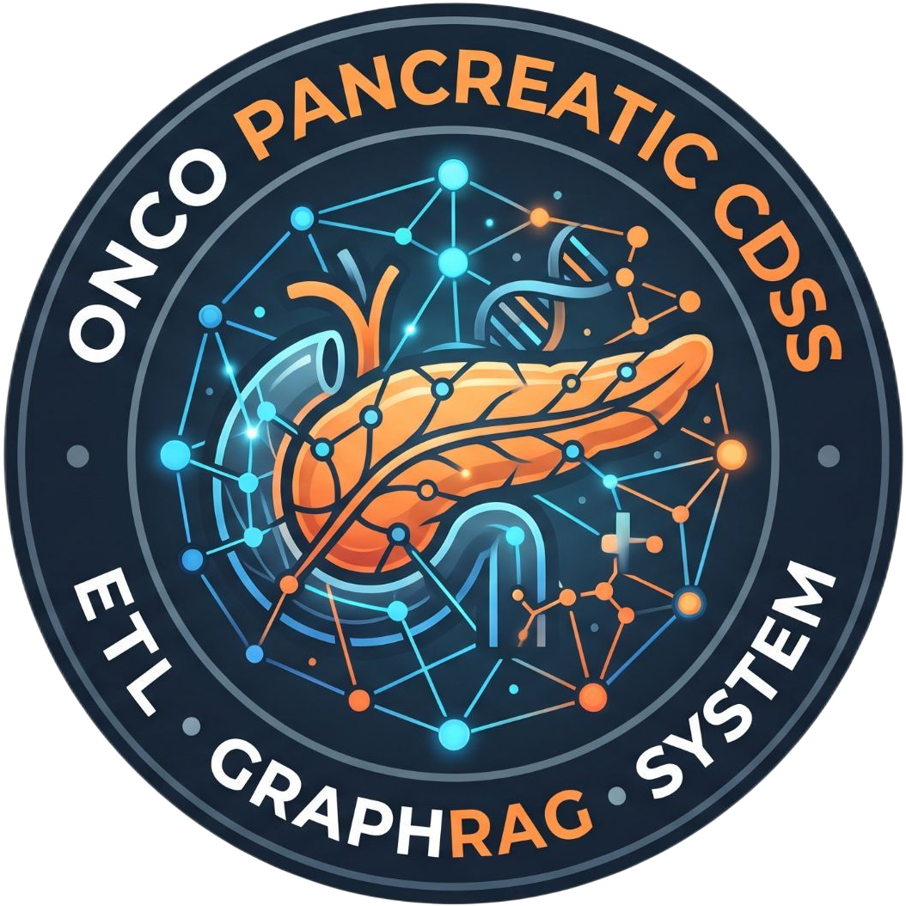
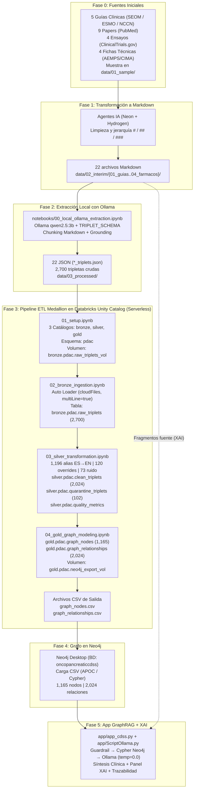
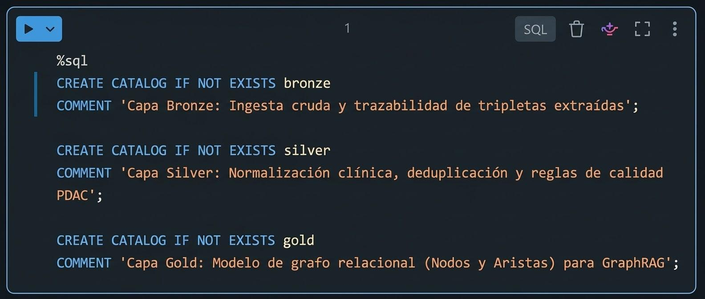
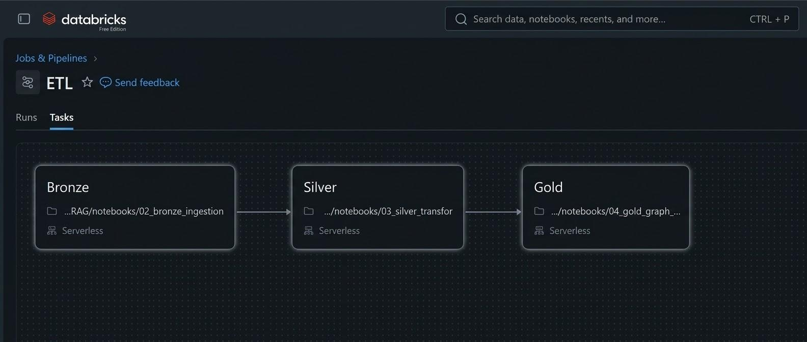
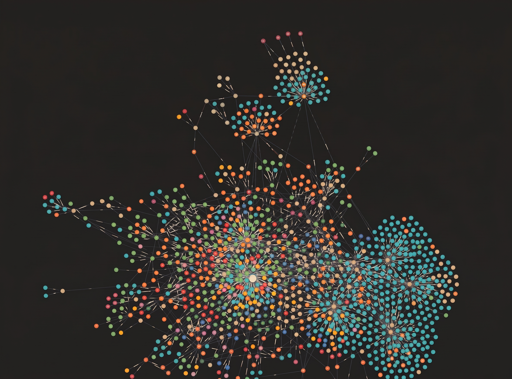
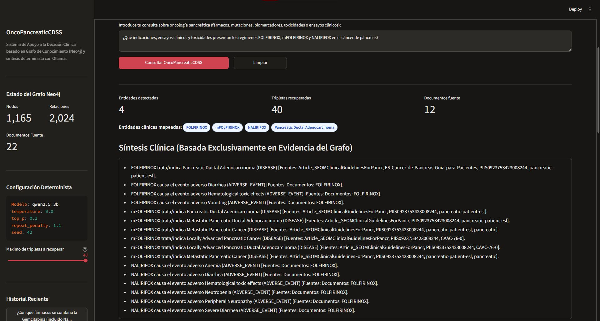
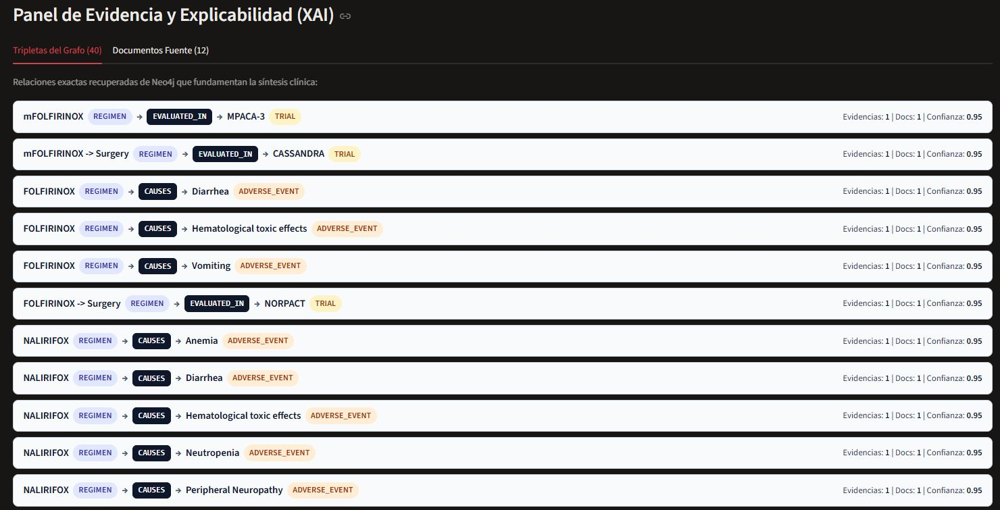

<p align="center">
  
</p>

<h1 align="center">OncoPancreaticCDSS — ETL Medallion + GraphRAG</h1>

<p align="center">
  <strong>Sistema de Apoyo a la Decisión Clínica (CDSS) para Adenocarcinoma Ductal Pancreático (PDAC)</strong><br/>
  Pipeline End-to-End desde documentos biomédicos heterogéneos hasta un Grafo de Conocimiento en Neo4j y consultas deterministas GraphRAG con Ollama y Streamlit.
</p>

<p align="center">
  <em>Autor: Adrián Vivar Moreno</em>
</p>

---

## Descripción General

**OncoPancreaticCDSS** transforma un corpus biomédico multilingüe (guías clínicas internacionales, artículos científicos de PubMed, ensayos clínicos y fichas técnicas farmacológicas) en un **grafo de conocimiento clínico estandarizado** y lo explota mediante una aplicación **GraphRAG determinista** con explicabilidad (**XAI**) y **cero alucinaciones**.

### Stack Tecnológico

| Capa / Fase | Tecnología Principal | Propósito |
| :--- | :--- | :--- |
| **Conversión documental** | Agentes IA (Orquestador Neon de Antigravity + modelos ligeros Hydrogen) | Transformación de PDFs (+100 págs.), JSON y TXT a Markdown estructurado (`data/02_interim/`) |
| **Extracción de tripletas** | **Ollama** (`qwen2.5:3b`) + JSON Schema estricto | Extracción local de tripletas `(sujeto, tipo_sujeto, relacion, objeto, tipo_objeto, score)` (`data/03_processed/`) |
| **Lakehouse & ETL** | **Databricks Free Edition (Serverless)** + **Unity Catalog** + **Delta Lake** + **Auto Loader** (`cloudFiles`) + **PySpark** | Gobernanza en 3 catálogos (`bronze`, `silver`, `gold`), limpieza, resolución de alias ES→EN, cuarentena y modelado de grafo |
| **Base de datos de grafo** | **Neo4j Desktop** (+ plugin **APOC**) | Almacenamiento, indexación y consulta Cypher de 1,165 nodos y 2,024 relaciones verificadas |
| **Aplicación CDSS & XAI** | **Python** + **Streamlit** + **Ollama** (`qwen2.5:3b`, `temperature=0.0`) | Interfaz clínica con guardrail de dominio, preguntas estrella, síntesis anclada al grafo y trazabilidad documental |

---

## Arquitectura End-to-End del Proyecto

El proyecto se ejecuta de forma secuencial en **6 fases (Fases 0 a 5)**, separando la extracción LLM local del procesamiento determinista en Databricks y de la consulta clínica sobre Neo4j:



---

## Cifras Clave del Pipeline (Métricas Verificadas)

| Etapa / Métrica | Valor | Detalle |
| :--- | :---: | :--- |
| **Documentos procesados** | **22** | 5 guías clínicas, 9 papers científicos, 4 ensayos clínicos, 4 fichas técnicas |
| **Tripletas crudas ingeridas (Bronze)** | **2,700** | `01_guias`: 1,301 · `02_papers`: 656 · `03_ensayos`: 153 · `04_farmacos`: 590 |
| **Tripletas válidas pre-deduplicación** | **2,598** | 96.22 % del corpus crudo |
| **Tripletas enviadas a cuarentena** | **102 (3.78 %)** | 96 `GENERIC_OR_NOISE_ENTITY`, 4 `SELF_LOOP_TRIPLET`, 2 `INVALID_ONTOLOGY_RELATION` |
| **Relaciones únicas limpias (Silver / Gold)** | **2,024** | **-22.09 %** por deduplicación y consolidación de evidencias |
| **Entidades crudas únicas** | **1,830** | Sensibles a mayúsculas (`1,728` insensibles a mayúsculas) |
| **Nodos canónicos en inglés (Gold / Neo4j)** | **1,165** | **-36.34 %** de reducción dimensional tras traducción ES→EN y resolución de alias |
| **Integridad referencial Gold** | **100 % PASS** | 0 aristas huérfanas, 0 IDs duplicados, 0 auto-bucles, 0 claves nulas |

---

## Orden Exacto de Ejecución (Paso a Paso)

### Fase 0 — Fuentes Iniciales de Datos (`data/01_sample/`)

El proyecto parte de **22 fuentes biomédicas heterogéneas** en español e inglés, incluyendo documentos extensos de **+100 páginas por PDF**, registros estructurados de ensayos clínicos y fichas farmacológicas oficiales:

| Subcarpeta | N.º Docs | Origen | Formato original |
| :--- | :---: | :--- | :--- |
| `01_guias` | 5 | Guías clínicas **SEOM**, **ESMO** y **NCCN** | PDF (+100 págs. en guías NCCN) |
| `02_papers` | 9 | Artículos científicos de **PubMed** (KRAS, FOLFIRINOX, resistencia) | PDF / TXT |
| `03_ensayos` | 4 | Ensayos clínicos de **ClinicalTrials.gov** (`NCT*`) | JSON |
| `04_farmacos` | 4 | Fichas técnicas de medicamentos **AEMPS / CIMA** | TXT |

En el repositorio se incluye una muestra representativa de los formatos de entrada en [`data/01_sample/`](data/01_sample):
- [`Article_SEOMClinicalGuidelinesForPancr.pdf`](data/01_sample/Article_SEOMClinicalGuidelinesForPancr.pdf) (guía clínica en PDF)
- [`Resistencia_farmacos.txt`](data/01_sample/Resistencia_farmacos.txt) (artículo científico en texto)
- [`NCT06115499.json`](data/01_sample/NCT06115499.json) (ensayo clínico PLATINUM en JSON)
- [`Gemcitabina.txt`](data/01_sample/Gemcitabina.txt) (ficha técnica AEMPS/CIMA en texto)

---

### Fase 1 — Transformación a Markdown (`data/02_interim/`)

Los archivos originales heterogéneos se transforman en documentos **Markdown limpios y jerárquicos** (`#`, `##`, `###`) mediante **Agentes de IA** (orquestador **Neon** de Antigravity coordinando modelos ligeros **Hydrogen**), eliminando ruido de maquetación y preservando tablas clínicas, secciones farmacológicas y estructura de ensayos.

Los **22 archivos `.md`** resultantes se almacenan organizados en cuatro subcarpetas dentro de [`data/02_interim/`](data/02_interim):
- `data/02_interim/01_guias/` (5 archivos `.md`)
- `data/02_interim/02_papers/` (9 archivos `.md`)
- `data/02_interim/03_ensayos/` (4 archivos `.md`)
- `data/02_interim/04_farmacos/` (4 archivos `.md`)

Además de alimentar la fase de extracción, estos archivos Markdown sirven posteriormente como **respaldo documental** para mostrar fragmentos reales en el Panel XAI de la aplicación Streamlit.

---

### Fase 2 — Extracción Local de Tripletas con Ollama ([`00_local_ollama_extraction.ipynb`](notebooks/00_local_ollama_extraction.ipynb) → `data/03_processed/`)

Ejecutado en local mediante [`notebooks/00_local_ollama_extraction.ipynb`](notebooks/00_local_ollama_extraction.ipynb) conectando con **Ollama** (`http://localhost:11434`, modelo **`qwen2.5:3b`**):

1. **Chunking consciente de Markdown (`split_markdown_into_chunks`):** fragmentos de hasta `2,000` caracteres (`overlap = 150`), anteponiendo la ruta jerárquica `[Contexto: Documento > Sección]` y omitiendo secciones de ruido (`References`, `Bibliography`, `Acknowledgements`, `Funding`, etc.).
2. **Esquema JSON estricto (`TRIPLET_SCHEMA`):** fuerza a nivel de tokens la salida `(sujeto, tipo_sujeto, relacion, objeto, tipo_objeto, score)` con 8 tipos de entidad y 7 relaciones iniciales.
3. **System Prompt clínico bilingüe (ES/EN) + *few-shot*:** baja temperatura (`temperature = 0.1`, con reintento automático a `0.25` si un bloque largo devuelve `0` tripletas) y rescate por expresiones regulares si el JSON se trunca.
4. **Validación inmediata por fragmento (`validate_and_clean_triplets`):** verificación de *grounding* textual (`_is_grounded_in_chunk`) para impedir alucinaciones de memoria, filtro de `GENERIC_STOPWORDS`, reglas ontológicas (`VALID_ONTOLOGY_RULES`) y deduplicación intra-documento.
5. **Salida generada:** **22 archivos `*_triplets.json`** en [`data/03_processed/`](data/03_processed) con **2,700 tripletas** totales listas para ingesta.

---

### Fase 3 — Pipeline ETL Medallion en Databricks Unity Catalog (`notebooks/01` a `04`)

El procesamiento distribuido y determinista se ejecuta en **Databricks Free Edition (Serverless)** siguiendo el orden estricto de los cuatro notebooks, sin llamadas a APIs externas ni uso de DBFS raíz (todo gobernado bajo **Unity Catalog** con 3 catálogos y volúmenes `/Volumes/...`):

#### 1. [`01_setup.ipynb`](notebooks/01_setup.ipynb) — Aprovisionamiento de los 3 Catálogos y Volumen de Entrada
Crea los **3 catálogos** (`bronze`, `silver`, `gold`), el esquema `pdac` en cada uno y el volumen de entrada `bronze.pdac.raw_triplets_vol` (`/Volumes/bronze/pdac/raw_triplets_vol`). Antes de pasar al siguiente notebook, se suben a ese volumen las 4 subcarpetas de `data/03_processed/` (`01_guias`, `02_papers`, `03_ensayos`, `04_farmacos`).



#### 2. [`02_bronze_ingestion.ipynb`](notebooks/02_bronze_ingestion.ipynb) — Ingesta Incremental Auto Loader (`bronze`)
- Lee de forma incremental los 22 JSON multi-línea desde `/Volumes/bronze/pdac/raw_triplets_vol` mediante **`cloudFiles`** (`multiLine="true"`, `SCHEMA_HINTS`, `schemaEvolutionMode="rescue"`, `trigger(availableNow=True)`).
- Almacena el estado de streaming en `_checkpoints/bronze_triplets` y `_schemas/bronze_triplets`.
- Despliega el array `tripletas` con `explode_outer` y enriquece cada fila con `_source_file`, `_file_name`, `_file_size`, `_file_modification_time`, `_source_folder`, `_source_domain`, `_ingestion_timestamp` y `_rescued_data`.
- **Tabla de salida:** `bronze.pdac.raw_triplets` (**2,700 filas**).

#### 3. [`03_silver_transformation.ipynb`](notebooks/03_silver_transformation.ipynb) — Limpieza, Normalización y Cuarentena (`silver`)
Aplica 7 etapas deterministas de PySpark (más auditoría en la etapa 8) sin ningún LLM:
- **Limpieza estructural:** preserva columnas `*_raw`, elimina marcadores Markdown (`_BRCA1_`), prefijos AEMPS (`De forma rara:`), prefijos ClinicalTrials (`Procedure:`), superíndices y normaliza guiones/flechas Unicode.
- **Traducción ES→EN y resolución de alias:** *broadcast joins* contra **1,196 reglas** (`ENTITY_ALIASES`: fármacos, regímenes, enfermedades, moléculas, estadios, procedimientos, efectos adversos y ensayos).
- **Estandarización semántica:** **120 *overrides* de tipo** (`ENTITY_TYPE_OVERRIDES`), **13 tipos de nodo** (`VALID_NODE_TYPES`), **12 predicados** (`VALID_PREDICATES`) y especialización de `ASSOCIATED_WITH` hacia `BIOMARKER_FOR`, `HAS_MUTATION` y `RISK_FACTOR_FOR`.
- **Control de calidad y cuarentena:** filtra **73 términos de ruido** (`GENERIC_NOISE_ENTITIES`), auto-bucles, longitudes inválidas, confianza `< 0.70` y violaciones ontológicas.
- **Consistencia de tipos y deduplicación:** unifica tipos por frecuencia/prioridad (`Window`) y consolida evidencias (`evidence_count`, `avg_confidence`, `max_confidence`, `doc_count`, `source_docs`).
- **Tablas de salida:**
  - `silver.pdac.clean_triplets` (**2,024** tripletas únicas limpias)
  - `silver.pdac.quarantine_triplets` (**102** tripletas rechazadas con `_rejection_reason`)
  - `silver.pdac.quality_metrics` (auditoría Antes vs. Después)

#### 4. [`04_gold_graph_modeling.ipynb`](notebooks/04_gold_graph_modeling.ipynb) — Modelado de Grafo y Exportación CSV (`gold`)
- Construye la tabla dimensional de nodos y la tabla de relaciones con claves deterministas SHA-256 (`n_<16 hex>` y `r_<16 hex>`), grado (`degree`), menciones totales (`mention_count`) y fuentes concatenadas por `;`.
- Ejecuta aserciones estrictas (`assert == 0`) garantizando **0 aristas huérfanas**, **0 duplicados**, **0 auto-bucles** y **0 nulos**.
- Crea el volumen **`gold.pdac.neo4j_export_vol`** (`/Volumes/gold/pdac/neo4j_export_vol`) y exporta los archivos CSV consolidados (`coalesce(1)`, `header=true`, `quoteAll=true`).
- **Tablas y archivos de salida:**
  - `gold.pdac.graph_nodes` → `/Volumes/gold/pdac/neo4j_export_vol/graph_nodes/` (**`graph_nodes.csv`**, **1,165 nodos**)
  - `gold.pdac.graph_relationships` → `/Volumes/gold/pdac/neo4j_export_vol/graph_relationships/` (**`graph_relationships.csv`**, **2,024 aristas**)



#### Resumen de Catálogos, Esquemas, Volúmenes y Tablas en Databricks

| Capa | Catálogo | Esquema | Volúmenes Unity Catalog | Tablas Delta | Archivos de Salida |
| :--- | :--- | :--- | :--- | :--- | :--- |
| **Bronze** | `bronze` | `bronze.pdac` | `bronze.pdac.raw_triplets_vol` | `bronze.pdac.raw_triplets` | — |
| **Silver** | `silver` | `silver.pdac` | — | `silver.pdac.clean_triplets`<br>`silver.pdac.quarantine_triplets`<br>`silver.pdac.quality_metrics` | — |
| **Gold** | `gold` | `gold.pdac` | `gold.pdac.neo4j_export_vol` | `gold.pdac.graph_nodes`<br>`gold.pdac.graph_relationships` | `graph_nodes.csv`<br>`graph_relationships.csv` |

---

### Fase 4 — Grafo de Conocimiento en Neo4j Desktop

1. Descarga los dos CSV desde `/Volumes/gold/pdac/neo4j_export_vol/` (`graph_nodes.csv` y `graph_relationships.csv`) y colócalos en la carpeta `import/` de tu base de datos `oncopancreaticcdss` en **Neo4j Desktop**.
2. Crea la restricción de unicidad e índice (`Entity.node_id` y `Entity.name`).
3. Ejecuta el script de carga `LOAD CSV WITH HEADERS` (con **APOC** para etiquetas dinámicas como `:DRUG`, `:GENE`, `:DISEASE`, `:TRIAL` y relaciones tipadas como `[:TREATS]`, `[:TARGETS]`, o con Cypher puro; ver scripts completos en [`DOCUMENTACION.md`](DOCUMENTACION.md#9-grafo-de-conocimiento-en-neo4j-desktop)).

El grafo resultante contiene **1,165 nodos** y **2,024 relaciones** procedentes de **22 documentos**:



> También disponible el vídeo demostrativo de exploración del grafo en [`presentation/knowledge_graph.mp4`](presentation/knowledge_graph.mp4).

---

### Fase 5 — Aplicación de Consulta GraphRAG al Grafo con Ollama + Streamlit (`app/`)

La capa de explotación clínica está implementada en [`app/ScriptOllama.py`](app/ScriptOllama.py), [`app/app_cdss.py`](app/app_cdss.py) y validada por [`app/test_graphrag.py`](app/test_graphrag.py):

1. **Guardrail estricto de dominio (`classify_domain`):** bloquea consultas ajenas a la oncología pancreática antes de tocar el grafo.
2. **Extracción determinista de entidades e intención (`extract_entities_from_question`):** normaliza términos del español al inglés para alinearlos con los nodos canónicos de Neo4j.
3. **Recuperación de subgrafo Cypher (`query_neo4j_subgraph`):** consulta Neo4j priorizando tipo de relación, `evidence_count` y `doc_count` (configurable de 10 a 40 tripletas desde la interfaz), y recupera automáticamente los fragmentos originales desde `data/02_interim/`.
4. **Síntesis clínica determinista Cero Alucinaciones (`ask_graphrag`):** envía únicamente el bloque `CONTEXTO VERIFICADO DEL GRAFO` a **Ollama** (`qwen2.5:3b` con `temperature=0.0`, `top_p=0.1`, `top_k=1`, `repeat_penalty=1.1`, `seed=42`, `num_ctx=4096`), exigiendo citas `[Fuentes: ...]` en cada viñeta y abstención literal (`NO_EVIDENCE_MSG`) si no hay hechos en el grafo.
5. **Interfaz Streamlit + Panel XAI (`app/app_cdss.py`):** incluye métricas en tiempo real de Neo4j, **5 Preguntas Clínicas Estrella** validadas, consulta libre, historial de sesión y un **Panel de Evidencia y Explicabilidad (XAI)** con todas las tripletas exactas, tabla exportable y fragmentos documentales.

#### Salidas Reales de la Aplicación GraphRAG

**1. Consulta clínica, métricas del grafo en barra lateral y Síntesis Clínica con citas trazables:**



**2. Panel de Evidencia y Explicabilidad (XAI) con las tripletas exactas recuperadas desde Neo4j:**



---

## Estructura del Repositorio

```text
OncoPancreaticCDSS-ETL-GraphRAG/
├── app/
│   ├── app_cdss.py                         # Interfaz web Streamlit con preguntas estrella y panel XAI
│   ├── ScriptOllama.py                     # Motor GraphRAG determinista (Guardrail + Neo4j + Ollama)
│   └── test_graphrag.py                    # Suite de validación (determinismo, guardrail, abstención, 5 estrellas)
├── data/
│   ├── 01_sample/                          # Muestra de fuentes iniciales (PDF, JSON, TXT)
│   ├── 02_interim/                         # 22 documentos transformados a Markdown (01_guias..04_farmacos)
│   └── 03_processed/                       # 22 JSON (*_triplets.json) con 2,700 tripletas extraídas
├── notebooks/
│   ├── 00_local_ollama_extraction.ipynb    # Extracción local de tripletas desde Markdown con Ollama
│   ├── 01_setup.ipynb                      # Creación de catálogos (bronze, silver, gold), esquema pdac y volumen
│   ├── 02_bronze_ingestion.ipynb           # Ingesta incremental Auto Loader (cloudFiles) hacia Bronze
│   ├── 03_silver_transformation.ipynb      # Limpieza, 1,196 alias ES→EN, cuarentena y métricas de calidad
│   └── 04_gold_graph_modeling.ipynb        # Modelado de nodos/aristas Gold, integridad 100% y export CSV
├── presentation/
│   ├── images/                             # Logo y capturas de Databricks y de la app Streamlit
│   ├── Knowledge_Graph.png                 # Visualización del grafo de conocimiento final en Neo4j
│   ├── knowledge_graph.mp4                 # Vídeo demostrativo del grafo final
│   └── OncoPancreaticCDSS-presentation.pdf # Presentación ejecutiva del proyecto
├── .env.example                            # Plantilla de variables de entorno para Neo4j y Ollama
├── .gitignore                              # Exclusiones de entorno y datos masivos
├── DOCUMENTACION.md                        # Documentación técnica completa (lista para exportar a PDF)
├── README.md                               # Guía general del proyecto
└── requirements.txt                        # Dependencias Python (neo4j, pandas, python-dotenv, requests, streamlit)
```

---

## Instalación y Uso Local de la Aplicación GraphRAG

### 1. Requisitos previos
- **Python 3.10+**
- **Neo4j Desktop** activo con la base de datos cargada (`oncopancreaticcdss` por defecto) y plugin **APOC** recomendado.
- **Ollama** instalado y en ejecución (`http://localhost:11434`) con el modelo `qwen2.5:3b`:
  ```bash
  ollama pull qwen2.5:3b
  ```

### 2. Instalar dependencias y configurar variables de entorno
```bash
pip install -r requirements.txt
```

Crea el archivo `.env` a partir de [`.env.example`](.env.example) (este archivo no se versiona):
```env
NEO4J_URI=bolt://localhost:7687
NEO4J_USER=neo4j
NEO4J_PASSWORD=tu_password_de_neo4j
NEO4J_DB=oncopancreaticcdss
```
*(Opcionalmente puedes sobreescribir `OLLAMA_URL` y `OLLAMA_MODEL`, que por defecto apuntan a `http://localhost:11434/api/generate` y `qwen2.5:3b`.)*

### 3. Ejecutar la aplicación web Streamlit y los tests de validación
```bash
# Lanzar la interfaz clínica GraphRAG + XAI
streamlit run app/app_cdss.py

# Ejecutar la batería completa de pruebas (determinismo 3x, guardrail, abstención y 5 preguntas estrella)
python app/test_graphrag.py

# Prueba rápida por consola sobre la pregunta estrella #1
python app/ScriptOllama.py
```

---

## Documentación Detallada y Presentación

- **Documentación técnica completa (preparada para exportación a PDF):** [`DOCUMENTACION.md`](DOCUMENTACION.md)
- **Presentación del proyecto:** [`presentation/OncoPancreaticCDSS-presentation.pdf`](presentation/OncoPancreaticCDSS-presentation.pdf)
